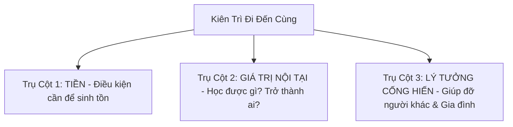

# 🧠 BỘ NÃO: LÀM SAO KIÊN TRÌ ĐẾN CÙNG MỌI VIỆC — DAN FOOLISH

[YouTube Video]
- **Tiêu đề:** Làm Sao Kiên Trì Đến Cùng Mọi Việc
- **Kênh:** Dan Foolish
- **URL:** https://www.youtube.com/watch?v=wB3tuUslLuM&t=576s
- **Timestamp trọng tâm:** 09:36 (576s) — *Lý Tưởng & Giá Trị Xã Hội Là Cội Nguồn Của Sự Kiên Trì: "Khi có một lý tưởng lớn hơn bản thân mình — tạo công ăn việc làm, xây cầu giúp người, báo hiếu cha mẹ — bạn sẽ có nguồn năng lượng vô tận để đi đến cùng mà không bao giờ bỏ cuộc!"*
- **Thời lượng:** 19 phút 18 giây (1158s)
- **Chủ đề:** Bản chất của sự kiên trì, tử huyệt khiến 90% người bỏ cuộc giữa chừng (cái bẫy chỉ làm vì tiền), công thức "Bộ 3 Trụ Cột Động Lực" và phương pháp duy trì năng lượng bền bỉ trong sự nghiệp, thể thao lẫn kinh doanh.

---

## 🧭 PHẦN 1: BỘ NÃO TINH HOA (CORE FRAMEWORKS & MENTAL MODELS)

### 1. Bản Chất Của Thành Công: "Làm Rất Lâu Một Việc" (The Power of Longevity)
* **Quy luật bất biến:** Tất cả những cá nhân hay thương hiệu thành công bền vững (như KFC, các chuỗi kinh doanh lớn, chuyên gia hàng đầu) đều có chung một điểm: **Họ làm một việc trong một khoảng thời gian RẤT LÂU**.
* **Lợi thế của người đi đến cùng:** Khi bạn kiên trì đủ lâu, bạn có thời gian để sửa sai, tối ưu sản phẩm, xây dựng niềm tin với khách hàng. 80–90% đối thủ sẽ tự động rớt đài trên đường chạy. Bạn không cần phải quá xuất sắc, chỉ cần **không bỏ cuộc là bạn đã chiến thắng số đông**.

---

### 2. Tử Huyệt Khiến 90% Người Bỏ Cuộc: Bẫy "Chỉ Làm Vì Tiền"
* **Nguyên nhân cốt lõi của sự đứt gánh giữa đường:**  
  * Đa số mọi người khi bắt đầu làm một công việc, một dự án hay khởi nghiệp, họ chỉ có **DUY NHẤT 1 LÝ DO: TIỀN**.
  * Trong 1–3 năm đầu tiên, thực tế luôn khắc nghiệt: tiền chưa về, dự án gặp trục trặc, thua lỗ, áp lực bủa vây.
  * Vì lý do duy nhất là tiền, mà lúc này **tiền không thấy đâu** ➔ Não bộ lập tức phát tín hiệu chán nản, mất động lực và **BUÔNG TAY BỎ CUỘC NGAY LẬP TỨC**.

---

### 3. Công Thức Đột Phá: BỘ 3 TRỤ CỘT ĐỘNG LỰC ĐỂ ĐI ĐẾN CÙNG
Để không bao giờ bỏ cuộc giữa chừng trong bất kỳ mục tiêu nào, bạn bắt buộc phải trang bị đủ **3 tầng lý do** vững chắc:

#### 🔹 Trụ Cột 1: TIỀN (Nền tảng sinh tồn tối thiểu)
* Cần tiền để trang trải cuộc sống, duy trì dòng tiền và tái đầu tư. Nhưng đây chỉ là điều kiện cần, không bao giờ đủ để giữ chân bạn khi bão tố ập đến.

#### 🔹 Trụ Cột 2: GIÁ TRỊ PHÁT TRIỂN NỘI TẠI (Self-Evolution)
* **Tư duy khi bước vào một công ty/dự án:**  
  > *"Khi tôi bước vào công ty này, có thể người ta không biết tôi là ai. Nhưng khi tôi bước ra, tôi phải là một người hoàn toàn khác — nâng cấp tư duy, làm chủ kỹ năng mới, giải quyết được bài toán khó."*
* Dù tiền lương có thể chưa đạt kỳ vọng ngay lập tức, bạn vẫn kiên trì cống hiến vì bạn hiểu mình đang **ĐƯỢC HỌC THỰC CHIẾN MIỄN PHÍ** và tích lũy "cơ bắp chuyên môn" cho chính mình.

#### 🔹 Trụ Cột 3: LÝ TƯỞNG CỐNG HIẾN & GIẢI QUYẾT BÀI TOÁN XÃ HỘI (Trọng tâm 09:36)
* **Năng lượng từ sự cống hiến:** Khi công việc của bạn gắn liền với một ý nghĩa lớn lao hơn sự ích kỷ cá nhân:
  * Giải quyết nỗi đau và vấn đề nhức nhối của khách hàng.
  * Tạo ra công ăn việc làm cho hàng trăm người, giúp họ có thu nhập gửi về nuôi cha mẹ, không trở thành gánh nặng xã hội.
  * Hoạt động thiện nguyện để đời (như việc Dan tự hào xây những cây cầu dân sinh có giá trị sử dụng 5–10 năm thay vì chỉ cho tiền tiêu xài ngắn hạn).
* **Sức mạnh vô hạn:** Khi gặp bế tắc và stress, chính trách nhiệm với người khác và lý tưởng xã hội sẽ kéo bạn dậy, tiếp cho bạn nguồn sinh khí vô tận để tiến lên.

---

### 4. Ứng Dụng Trong Thể Thao: Vượt Ngưỡng Giới Hạn Bản Thân
* Nếu bạn chạy bộ hay tập gym chỉ để "khoe thành tích" hay "sống ảo", bạn sẽ bỏ cuộc ngay khi cơ bắp đau nhức, hơi thở đứt quãng.
* Nhưng khi bạn tập luyện vì **sức khỏe trường tồn, vì tinh thần kỷ luật và để làm tấm gương cho người khác**, bạn sẽ xem sự khó chịu là phần thưởng và hoàn thành trọn vẹn từng buổi tập.

---

### 5. Chiến Lược Tăng Lương & Thăng Tiến Vượt Trội Dành Cho Người Đi Làm Thuê
* Người làm việc với tâm thế 3 trụ cột sẽ không bao giờ thụ động:
  1. Luôn chủ động tìm giải pháp và tối ưu hóa quy trình thay vì ngồi chờ sếp chỉ việc.
  2. Tạo ra giá trị thặng dư gấp nhiều lần mức lương hiện tại.
  3. Sau 6 tháng – 1 năm, tự tin ngồi đàm phán thăng tiến: *"Em đã cống hiến giá trị A, B, C; em đã giải quyết bài toán X, Y; em xứng đáng với vị thế mới."* Nếu công ty không trọng dụng, giá trị thực chất đó sẽ được thị trường săn đón ngay lập tức.

---

## 🎯 PHẦN 2: BẢNG SOI CHIẾU & HÀNH ĐỘNG KỶ LUẬT CHO HIẾU LÊ VĂN

| Bài học của Dan Foolish | Soi chiếu vào thực tế cuộc sống của Hiếu | Kỷ luật hành động cụ thể |
| :--- | :--- | :--- |
| **Bẫy "Chỉ làm vì tiền" dễ bỏ cuộc** | Hiếu từng có lúc quá tải và stress khi ôm đồm nhiều job (TMA + BIT + Miracle) chỉ để tối đa hóa số tiền trong ngắn hạn. | • Tinh gọn mục tiêu: Đóng băng Miracle POS để không bị phân tán năng lượng. • Xác lập tâm thế: Đi làm không chỉ vì 15-17tr tiết kiệm, mà vì hành trình nâng cấp bản thân. |
| **Trụ Cột 2: Giá trị nội tại (TMA Solutions)** | Làm việc tại TMA không đơn thuần là hoàn thành task kiếm lương hàng tháng. | • Bước vào TMA với mục tiêu: Luyện năng lực kiến trúc hệ thống, CI/CD, giải quyết bài toán khó để xứng đáng danh hiệu **Senior TMA 2027**. • Tận dụng môi trường TMA để cọ xát, nâng trình chuyên môn không ngừng. |
| **Trụ Cột 3: Lý tưởng lớn (Trọng tâm 09:36)** | Động lực tối thượng giữ cho Hiếu không bao giờ bỏ cuộc. | • **Đạo hiếu với mẹ:** [QUY_ME_500TR.md](../../../01_ROADMAPS/M5_RELATIONSHIPS/QUY_ME_500TR.md) (bảo vệ mẹ đến 2036, mốc 100M trích lãi nuôi mẹ) là lời hứa danh dự của một người đàn ông. • **Sứ mệnh học thuật:** Chuẩn bị Thạc sĩ UIT (2027) để trở thành **Giảng viên Đại học (2029)**, truyền cảm hứng và đào tạo thế hệ kỹ sư tương lai. |
| **Kiên trì trong Tiếng Anh (90 Ngày All-in)** | Học tiếng Anh rất dễ nản nếu chỉ nghĩ đến tấm bằng TOEIC để nộp công ty. | • Mở rộng tầm nhìn: Tiếng Anh là chìa khóa để tiếp cận tri thức nhân loại, đọc tài liệu AI/Engineering toàn cầu, giao tiếp tự tin và đứng lớp giảng dạy sau này. |
| **Kiên trì trong Thể lực (Gym InBody)** | Tập gym 4 buổi/tuần và chạy bộ đòi hỏi chiến thắng cơn lười biếng mỗi sáng/tối. | • Xem phòng gym là "lò rèn ý chí thép". Mục tiêu 72-75kg không chỉ vì ngoại hình, mà để có năng lượng đỉnh cao gánh vác sự nghiệp và gia đình. |

---

## ⏱️ PHẦN 3: TIMELINE & CÁC CHƯƠNG MỤC CHI TIẾT

* **[00:00:00 - 00:01:14]:** Đặt vấn đề: Tại sao kiên trì làm tới cùng là mẫu số chung của mọi cá nhân và thương hiệu thành công?
* **[00:01:14 - 00:02:54]:** Sức mạnh của thời gian và đường dài (Ai ở lại cuối cùng là người chiến thắng).
* **[00:02:54 - 00:05:24]:** Tử huyệt bỏ cuộc: Cái bẫy chỉ làm vì tiền (Khi tiền chưa về là lập tức buông xuôi).
* **[00:05:24 - 00:08:31]:** Trụ cột 2: Giá trị phát triển bản thân (Bước vào vô danh, bước ra phải là người có trình độ vượt trội).
* **[00:08:31 - 00:11:45]:** **[09:36 - 576s Trọng tâm]** Trụ cột 3: Lý tưởng cống hiến xã hội & Động lực thiêng liêng từ gia đình (Xây cầu từ thiện, tạo việc làm, báo hiếu cha mẹ).
* **[00:11:45 - 00:14:36]:** Ứng dụng công thức 3 trụ cột vào rèn luyện thể thao & duy trì năng lượng đỉnh cao suốt ngày dài.
* **[00:14:36 - 00:17:21]:** Phương pháp tăng lương và thăng tiến thần tốc dành cho người làm thuê khi sở hữu tư duy cống hiến giá trị.
* **[00:17:21 - 00:19:18]:** Lời kết đanh thép: Không ỷ lại, không đổ lỗi hoàn cảnh; người trẻ chỉ có 1 con đường duy nhất là **HÀNH ĐỘNG VÀ ĐI ĐẾN CÙNG**.

---

## 📜 PHẦN 4: TOÀN BỘ TRANSCRIPT CHI TIẾT (FULL TEXT & TIMESTAMPS)

**[00:00]** [âm nhạc] Xin chào các bạn nãy tôi đã quay trở lại với số b cá tuần này thì tuần này tôi sẽ nói về cái nội dung là Kiên trị đến cùng hoặc là làm sao để mà Kiên trị đến cùng trong mọi việc hoặc là làm sao để mà em không bỏ cuộc hoặc Làm sao để em làm tới nơi tới chốn không giữa dở gian giữa

**[00:00]** chừng hoặc là một giải pháp nào đó để những người thành công họ từ một thứ từ Zero trở nên vị đại thì hôm nay tôi sẽ chia sẻ cái nội dung liên quan đến cái điều này Tại vì thực ra hiện tại là tôi thấy rất nhiều anh em cái gì cũng biết hết cái gì cũng nhúng tay vô xíu hết và hầu như nó là một cái vấn nạn của nhiều

**[00:00]** người trẻ Việt Nam là làm cho vui Làm cho có làm để trải nghiệm và nó không hề có một cái mục tiêu một cái Lý Tưởng một cái điều gì đó làm để trở nên to lớn hoặc là một cái điều gì đó để đến cùng trong lịch sử tất cả cái công ty mà họ có sự thành công thì họ đều có một điểm chung thứ nhất là họ làm rất là lâu

**[00:01]** đời 10 năm 15 năm 20 năm đó là trên thế giới còn Việt Nam bạn nhìn quan sát những công ty nào trên 5 năm 7 năm trên 10 năm thì hầu như họ sống rất là khỏe cho nên cái câu chuyện á Khi chúng ta làm đến cùng á Nó có rất nhiều cái giá trị tạo ra và cái khả năng Win nó cực kỳ cao tại vì trong quá trình Bạn làm bạn

**[00:01]** sẽ sửa sai bạn sẽ tu và bạn liên tục đứng dậy sai là sửa sai là sửa thì thì sau một thời gian mà sẽ là chuyên gia trong lĩnh vực b là nhưng mà đặt câu hỏi là làm sao để bây giờ tôi có cái lý do có động lực để tôi làm đến cùng thì cái điều này tôi sẽ nói trong cái Podcast này nhưng mà tôi khẳng định lại một lần

**[00:01]** nữa là tất cả những thứ gì chúng ta làm khi chúng ta làm đủ lâu nó đều thành công tất nhiên chúng ta phải chọn đúng từ đầu còn chọn sai nhưng mà chúng ta vẫn nỗ lực chúng ta làm tới cùng nó vẫn ra vấn đề nha bạn bán một tô bốn riêu nhưng bạn tối ưu liên tục Nghĩ giải pháp Marketing liên tục bạn nghĩ đ giải pháp

**[00:02]** nhân bản nhiều nhân sự mở nhiều chi nhánh bạn vẫn có cơ hội thành công bạn làm 10 năm bạn bán bún riêu mỗi tháng lợi nhuận đều Đặng 50 70 triệu là chuyện hết sức bình thường thì chắc chắn nó cũng ra câu chuyện bạn bán quần áo bạn bán về dép cũng vậy cho nên nhiều khi nhiều anh em chia sẻ là sao Anh không

**[00:02]** làm tren Sao anh không chạy theo xu hướng Sao anh không làm cái này làm cái kia làm cái nọ thì quan điểm của tôi cái gì tôi nhắm được đường dài Tôi mốn làm còn không đường Dạ tôi không làm rồi vô thẳng vấn đề thì để giải quyết bài toán này thì nó chỉ có cho các bạn một cái ky duy nhất thôi cực kỳ đơn giản và cực kỳ

**[00:02]** dễ hiểu Nhưng mà quan trọng Chúng ta kỷ luật được không nha tức là hãy xác định được cái lý tưởng để chúng ta lao vào cái công việc đó Cái thứ đó và nên tối thiểu là Có ba lý do đủ lớn nó tạo được cảm hứng cho chúng ta đủ lớn nha các bạn nha lý do đủ lớn không đủ lớn đừng làm và những cái lý do đủ lớn nó phải liên

**[00:02]** quan thứ nhất là đến cái sự phát triển tồn vong thịnh vượng của mình và gia đình mình và tiếp theo liên quan đến xã hội và tiếp theo nữa nó liên quan tới con người liên quan tới khách hàng liên quan đến những vấn đề xung quanh chúng ta Tôi ví dụ ví dụ khi bạn làm kinh doanh nếu bạn đ Kinh Doanh Bạn đặt mục

**[00:03]** tiêu là g em chỉ có làm vì tiền thôi hoặc khi bạn đi làm thuê cho một ông chủ bạn chỉ suy nghĩ Trung đầu là em chỉ làm vì tiền thôi Thì chắc chắn bạn sẽ có tiền nhưng mà những khó khăn và những vấp ngã những cái khúc mà bạn không có tiền mà phải gồn lỗ á hoặc những lúc mà doanh nghiệp khó khăn á hoặc là những

**[00:03]** lúc mà công ty gặp vấn đề này vấn đề kia ví dụ thì bạn sẽ buông bỏ bạn sẽ dừng Ngay thất bại ngay nghĩ ngay lập tức luôn Không nói nhiều đơn giản tôi hết tiền tôi cũng làm kinh doanh cũng y gian như vậy nếu chúng ta đặt mục tiêu mở quán cà phê này ra để kiếm tiền thôi thì ok bạn sẽ kiếm tiền nhưng khi không có

**[00:03]** tiền thì sao thì chúng ta phải có thêm một cái lý do khác đủ lớn Kiếm tiền là một lý do đủ lớn th các bạn Nhưng mà thêm một lý do đủ lớn tôi sẽ lấy một số ví dụ để các bạn dễ hình dung ví dụ khi bạn làm doanh nghiệp thì bạn đặt mục tiêu là gì Tôi mở một doanh nghiệp ra tôi phải giải quyết vấn đề cho một T

**[00:03]** khách hàng đó Và khi tôi giải quyết vấn đề cho một tạp khách hàng đó chắc chắn tôi sẽ có nhiều khách hàng và nhiều khách hàng họ sẽ truyền tay nhau họ hài lòng về tôi và họ sẽ giới thiệu thêm nhiều khách hàng nữa và tôi tạo ra một cái giá trị trong ngành ví dụ trong ngành bất động sản đi bất kể sale nào họ

**[00:04]** cũng bán bất chấp cái lòi ra một ông xe ổng bán cực kỳ có tâm cực kỳ tâm huyết và ổng support có nghĩa là khi khách hàng đã mua xuống tiền rồi ổng support ổng chăm sóc phía sau rất là tốt thì khi mua thì khách hàng họ lại giới thiệu thêm nhiều người khác à Thằng sale này nó không giống như người khác ví dụ

**[00:04]** thằng thằng a hàng B thằng C Hằng Cường Hằng kia thằng nam kiểu vậy nó không giống những thằng khác nó có một cái tư duy rất là tốt về chăm sóc và sơ Việt khách hàng tôi mua nó mấy lô đất rồi nè Và tôi vẫn muốn mua tiếp B nó thì đó chính là chúng ta đang giải quyết cái vấn đề cái nỗi đau của người cái này ví

**[00:04]** dụ khi mà bạn mở ra một cái quán cà phê bạn phải thấu hiểu rằng là gì à Khách hàng họ tới họ cần một cái chỗ ngồi lại thì bạn để ý là những cái cy C những cái người mà họ làm kinh doanh thành công ví dụ như là KFC cũng vậy khi mà họ ra đời họ giá quý Bài toán gì một cái thức ăn nhanh một cái món ăn làm sao để người ta

**[00:04]** không mất quá nhiều thời gian và tiếp theo là gì Người ta có thể mua về nhà người ta ăn teck away không phải ngồi tại chỗ nó giải quyết được cái giá rẻ cho những người lao động thì đó là những cái lý tưởng của KFC thì những điều đó họ làm và họ kiên trì chắc chắn trong 5 năm

**[00:05]** đầu tiên thất bại khó khăn rất là nhiều bạn h lên màng bằn sật doanh nghiệp nào cũng vậy cả nhưng mà vượt qua cái ngưỡng 5 năm đó bắt đầu khách hàng biết tới nhiều hơn Tại vì sao vì họ đã giải quyết được vấn đề cho số đông Họ giới thiệu và lan tỏa ra cái giá trị thự th sự của KFC và trong thời điểm đó không ai làm việc

**[00:05]** đó thì thế là họ thành công câu chuyện cũng quay lại ví dụ tôi lấy bản thân tôi ra khi mà tôi ra tôi kinh doanh tất cả nh doanh nghiệp hiện tại tôi làm á là đều hầu như trên 5 năm hết các bạn và khi tôi ra kinh doanh nếu tôi chỉ đặt cái việc là gì Tôi đặt mục tiêu là chỉ kiếm tiền thôi đó lý do tại sao Ngày xưa

**[00:05]** tôi rất hay bỏ cuộc tôi làm tới một cái ngưỡng không có tiền tụi chừng thì trôm ra doanh nghiệp của tôi ngoài cái giá trị nó tạo ra tiền của tôi nó chẳng tạo ra được cái giá trị bất cứ gì cho xã hội cả nhưng mà sau này tôi làm tôi ý thức là gì à khi mình kinh doanh mình tạo được nhiều công ăn việc làm nè mình tạo

**[00:06]** ra được nhiều cái giá trị xã hội bằng cách là gì Mình phục vụ khách hàng thực sự tốt khách hàng đ cầm lane mình sẽ tối ưu hóa và mình giải quyết cho họ để họ hài Lộng nhất có thể và sau đó mình có tiền mình sẽ đi mua cái này mua cái kia mua cái nọ cho chính gia đình mình cho chính bản thân mình mình tối ưu hóa gia

**[00:06]** đình mình lên và doanh nghiệp mình mình lấy cái tiền đó mình tái đầu tư mình mở thêm cái A cái BKC trong doanh nghiệp của mình trong cái chuỗi của mình cái thời xưa cái quan điểm của tôi là cái gì làm không có lời tôi không có làm nhưng mà gần đây những giai đoạn gần đây một số cái nó không có lời tôi vẫn làm đối

**[00:06]** với bạn tôi á ngày xưa cái cái mảng zim cái mảng phí này tôi rất là thích nhưng mà chắc chắn là khi tôi làm cái lợi nhuận nó không bằng một gốc những cái gì tôi đang làm những cái việc khác nhưng mà nếu mà tôi cứ chú tâm vào cái chuyện là à Nó phải cái lợi nhuận tôi mới làm thì không bao giờ Tôi đụng vô cái mảng

**[00:06]** đó Mặc dù tôi rất là thích nhưng mà nếu cái mảng đó tôi thích mà nó lại tạo được công ăn việc làm cho nhều anh em nó tạo ra được một cái giá trị cho khách hàng tất nhiên mình phải tìm được cái việc là mình phải giải quyết vấn đề khách hàng nha Chứ mở ra một doanh nghiệp mình kinh doanh mà mình không giải quyết được bất

**[00:06]** kỳ vấn đề nào cho khách hàng thì bỏ đi rồi Các bạn cũng giống câu chuyện đi làm thuê cũng vậy khi mình bước V doanh nghệp mình cứ chú trọng gì à tôi nhận được bao nhiêu đồng lương thì sớm muộn bạn không bao giờ ngồi ở doanh nghiệp với lâu được một là bạn sẽ tự đi chỗ khác bạn nghỉ tại vì có chỗ khác trả

**[00:07]** bằng cao hơn nhưng mà cũng sẽ có những lúc doanh nghiệp sẽ xa thải bạn Tại vì sao bạn không hề tạo được cái giá trị nào lớn hơn những cái gì Bạn đang bạn đang mong muốn cái việc kiếm tiền nhưng mà khi bạn làm bạn cống hiến bạn suy nghĩ là gì Tôi muốn bước vô doanh nghiệp này khi tôi bước vô người ta không biết

**[00:07]** tôi là ai nhưng tôi khi bước ra tôi phải có giá trị nhất định t doanh nghiệp này ví dụ tôi là một người làm Marketing thì nhìn vô cái doanh nghiệp này cái b này thì họ phải đánh giá là gì à Cái thằng này nè thằng An nè thằng Cường nè thằng Nam Thằng Huy nè Nó là cái thằng giải quyết được cái vấn đề marketing cho

**[00:07]** doanh nghiệp này sáng sủa không Rất là sáng sủa và khi bạn là một người làm trong phòng nhân sự phòng tuyển dụng rất nhiều người giỏi được tôi mời về doanh nghiệp này bạn tạo được cái giá trị to lớn doanh nghiệp khi bạn đi ai cũng nhớ bạn hết Cái quan điểm của tôi nha khi mà đã bước vô làm doanh nghiệp mà khi bạn

**[00:07]** nột một cái đơn sinh nghĩ việc á mà không ai níu kéo bạn hết là nó chẳng khác gì một cái việc x thải âm thầm các bạn thực sự là như vậy Ngày xưa tôi đi làm công cũng Di Chang như vậy là khi tôi đi làm tôi cống ng hết mình và tôi chứng tỏ là gì có nghĩa là ngày xưa tôi làm tôi được một cái là quan điểm của

**[00:08]** tôi là ngoài cái việc kiếm tiền ra thì tôi phải học được thêm cái điều gì đó có nghĩa tôi có một cái lý tưởng khác nữa là ngoài việc kiếm tiền tôi sẽ học tôi học từ người Sếp của tôi đồng nghiệp của tôi và tôi học từ những khách hàng của tôi những khách hàng của tôi nhiều tiền tôi sẽ học từ họ kiểu kiểu như vậy và

**[00:08]** khi bắt đầu mình học mình tương tác mình phát triển và có những giai đoạn mình làm tiền không có nhưng mà mình rất là lý tưởng cái chuyện mình cống hiến cái việc đó thì mình làm mình càng làm cấp trên mình yêu quý khách hàng yêu quý tất cả mọi người đều yêu quý thì đó là cái giá trị của người tạo ra thì đầu ti là

**[00:08]** chúng ta phải có một cái lý do lớn nhất đơn giản là phải có tiền tiếp theo là phải luôn chứng tỏ được cái giá trị của mình cái giá trị con người mình không phải là bạn đeo trên người cái đồng hồ gì đi cái xe gì mà giá trị trên người của bạn là bạn làm được cái điều gì đó cho những người xung quanh và cho khách

**[00:08]** hàng cho xã hội ví dụ như nhh nghiệp của tôi khi mà làm nó sẽ có những lúc chồi sục lên xuống có những lúc khó khăn những lúc vấp ngã Có những lúc mà làm Mình rất là stress nhưng mà có điều tôi cực kỳ tự tin và cực kỳ tự hào là doanh nệp của tôi xây được nhiều cây cầu vì bản n Tôi thích cái việc đó vì đối với

**[00:08]** quan điểm của tôi xây cái cầu Nó giúp cho mình về tâm linh giúp ích được cho bà con nó làm cho mình được câu chuyện là gì ý thức cái việc là gì mình phải cống hiến cho xã hội một cái cầu nó giá trị sử dụng lâu dài bây giờ bạn cho người đó 50 triệu 70 triệu cho 100 triệu nó cũng hết nhưng cái cầu để đó bà con

**[00:09]** sử dụng 5 năm 7 năm 10 năm rất là lâu giá trị sử dụng cao thì tôi cảm thấy Happy và thấy giá trị khi mình làm công việc kinh doanh của mình kiểu kiểu như vậy và khi mà ví dụ bạn làm trong doanh nghiệp của bạn đó là hai lý do Còn lý do số ba có thể các bạn sẽ suy nghĩ thêm một lý do nào đó như nãy tôi có nói là

**[00:09]** chúng ta sẽ giải quyết vấn đề của khách hàng giải quyết vấn đề của xã hội mình tạo ra nhiều công ăn việc làm một doanh nghiệp ra đời 50 100 200 300 nhân sự đó chính là một cái bạn tạo ra được 300 cái công việc làm giúp cho người ta có cái thu nhập giúp cho người ta không là một gánh nặng của gia đình của họ và giúp

**[00:09]** người ta có giá trị hơn bạn giúp ra bao nhiêu con em họ có thể gửi tiền về cho cha mẹ của họ thì đó là cái giá trị lớn khi bạn làm doanh nghiệp làm business Còn khi bạn đi làm làm thuê làm bạn cống hiến cho công ty cũng vậy thì mỗi khi mà bạn làm việc bạn chia sẻ bạn lan tỏa những tích cực trong doanh nghiệp của

**[00:10]** bạn thì đó cũng là cái giá trị của bạn tạo ra thì đó là cái định nghĩa của tôi là hãy xác định cái lý tưởng khi mà bạn bắt đầu cái việc đó bất kể mọi thứ luôn Tôi đang nói công chuyện là đi làm kiếm tiền ha bạn cơm má gọi tiền đi và tối tiểu hãy Có ba lý do lớn và liên tục nó tạo cảm ứng cho mình và nhớ vù tôi nè

**[00:10]** Quan điểm của tôi ngày xưa nó nó nó hơi bị gò bó Và tôi thấy là rất nhiều anh em giống giống cái quan điểm của tôi ngày xưa nha Nhưng mà bây giờ khi mà tôi tôi ngậm lại và tôi thấy thế này nè mỗi cái hành trang của mình đi mỗi cái cái bước đi của mình mỗi sự chăm chỉ và phát triển bản thân của mình mỗi ngày nó

**[00:10]** không chỉ giúp ích cho mình giúp ích cho những người xung quanh của mình và đặc biệt các bạn biết live không là cho thế hệ sau này dùng cái từ mà nó hơi nghe nó hơi mỉ mều là hậu duệ đó các bạn là con các bạn là cháu các bạn bây giờ bạn làm biến thì con bạn nó cũng sẽ làm biến thôi tôi có những người trong gia đình

**[00:10]** của tôi lâu lắm rồi tôi không gặp nhưng mà nhiều khi tôi thắc mắc là tại sao họ có một số cái nhà cho thuê mà họ không làm gì hết và con cái họ cũng y chang như vậy cháu Chắc của họ cũng y ch như vậy họ không làm họ không kinh doanh họ cũng chả có đi làm thuê làm mướn cho ai hết họ cứ ở nhà họ đi chơi vậy từ ngày

**[00:11]** này khác từ năm này năm khác hai ba chục năm cũng vậy t khi họ nằm xuống con cái họ sâu xé những cái nhà đó Vì nó không có khả năng lao động nó không không có khả năng kiếm tiền cái việc của nói về cái nhà chia ra thôi đó điều rất là đáng buồn mà nếu xã hội chúng ta nó cứ vô câu chuyện như vậy thì làm sao phát triển

**[00:11]** được các bạn thực ra nhiều anh em rất là giỏi nhiều anh em nền tảng rất là tốt chúng ta hãy cố gắng chúng ta làm chúng ta tạo ra giá trị trong chính công việc và từng ngày từng ngày của chúng ta luôn các bạn chúng ta hơn nhau chỗ đó đó chứ không phải hơn nhau cái chuyện là bạn bao nhiêu tiền Bao nhiêu tài sản đâu các

**[00:11]** bạn cho nên nhiều khi các bạn cũng đừng có áp lực cái chuyện là người này người kia họ s ấp về xe nhà thế này thế kia nó không quan trọng quan trọng bạn đang sống có giá trị hay không đó là điều tuyệt vời rồi khi bạn đang sống có giá trị bạn hơn rất là nhiều người các bạn quay lại câu chuyện Nếu trong thể thao

**[00:11]** cũng vậy khi mà bạn bước tới thể thao bạn chỉ suy nghĩ là gì Tôi muốn có thành tích cao Tôi muốn phải gọi là ờ chơi để mà hơn người này hơn người kia thắng thua thế này đế kia thế nọ thì khi mà bạn Ờ rất dễ bị tụt mod Tôi đang nói V vấn đề tụt mod trong thể thao ha thì khi mà bạn thành tích bạn không tốt bạn tụt

**[00:12]** mod ngay tôi cũng từng vướng vô luôn các bạn nhưng khi bạn đặt mục tiêu là gì à thể thao Nó như là một cái gọi là thể thao Nó như một cái triết lý sống nó như một cái lifestyle mỗi ngày bạn thức dậy Bạn phải làm một tí để bạn lấy tinh thần Bạn lấy năng lượng và bạn đổ tí mồ hôi để sẵn sàng cho một ngày làm việc nó

**[00:12]** hiệu quả nhất thì bạn để ý đi bạn lên bằng S tất cả những cái lịch làm việc một ngày của những CEO hàng đầu thế giới thì họ luôn có một chút thể thao 30 phút tên một tiếng dậy đánh răng rửa mặt Ngồi thiền xong rồi thể thao ai cũng như nhau hết thể thao xong rồi sau đó vô check mail làm việc lên kế hoạch một ngày Ví

**[00:12]** dụ như tôi bây giờ tôi đang làm Podcast là đúng cái ngày này tôi sẽ cố gắng tôi tập trung Tôi làm thì trước đó tôi đã chơi thế thao bắt đầu Tôi check list công việc và sau đó tôi bắt đầu thực thi từng cái trong ngày và nó cảm giác nó cực kỳ hiệu quả cuối ngày về mình vẫn thấy mình còn tràn trề năng lượng thì nó

**[00:12]** nó như một cái triết lý sống các bạn có nghĩa là bạn phải làm xíu buổi sáng vậy đó và nhìn lâu về dài sau này bạn s B chụ tuổi Bạn còn sức khỏe còn sức bệnh và hơn hết là giúp cho bạn có một cái trí tuệ minh mẫn để bạn đ làm được cái A cái b cái c cái d chứ không phải chơi th thao để hơn thôi và ví dụ nha Tôi ví dụ

**[00:13]** câu chuyện tiếp nếu mà bản thân tôi nếu mà bản thân chúng ta bản thân tôi nè mà tôi làm những cái YouTube này mà tôi đặt nặng cái chuyện là view sub rồi người theo dõi thế này thế kia thì tôi sẽ không bao giờ làm được các bạn V dụ ngày xưa tôi làm tiktok lên nói xàm Xà xà 500 triệu view rất là dễ dàng trong vòng 24

**[00:13]** tiếng nhưng khi làm YouTube này nhiều khi 10.000 15.000 sau tuần còn khó nữa đó nhưng mà mình ý thức là gì À cái việc làm YouTube này nó giá trị hơn rất là nhiều cái việc mà làm tiktok nó giá trị rất là nhiều cái việc mình làm tiktok vì một clip tiktok nó chỉ có 1 phút rưỡi 2 phút nó không truyền tải nội dung và câu

**[00:13]** chuyện là khi mình làm tiktok lại quá nhiều người biết đến mình thì mình lại không không không h không Không mình không enjoy được cái việc đó mình muốn mình lẳng lặn thôi Thì đó chính là khi mà bạn đặt được cái Lý Tưởng một cái giá trị ra thì nó sẽ giúp cho bạn hai thứ Thứ nhất Nó giúp cho bạn bắt đầu và thứ

**[00:13]** hai nó giúp cho bạn kết thúc các bạn cái cấn lớn nhất trong cái xã hội này hiện tại là không dám bắt đầu vì chúng ta cân đo trong đếm chúng ta tham lam chúng ta Quá nhiều thứ tôi làm thì phải có tiền tôi mới làm nhưng mà nếu nó nó có những giá trị sau bạn vẫn làm mà và lưu ý giùm tôi nè bạn để ý xung quanh bạn đi có cái

**[00:14]** gì mà làm lâu năm mà không có tiền không các bạn quan trọng Chúng ta có theo được lâu năm hay không bán cà phê lâu năm cũng có tiền bán quần áo lâu năm cũng có tiền bán bún riêu lâu năm cũng có tiền nhưng mà chúng ta phải ý thức là chúng ta phải làm tốt hơn mỗi ngày giá trị hơn mỗi ngày nha Chứ lâu năm mà chúng ta cứ

**[00:14]** nằm ngang chúng ta cứ phè phè phè những cái sii không sửa thì không bao giờ chúng ta tối ù phát triển mà có tiền được các bạn hình như nãy tôi nói nó phải Có ba lý do tố thiểu là phải có tiền Thứ hai là phải có giá trị và thứ ba là phải tạo được giải quyết được cái vấn đề của khách hàng thì giờ nếu bạn mở

**[00:14]** doanh nghiệp Bạn kinh doanh một cái điều gì đó hoặc bạn đi làm thuê mà bạn giả quý được ba bài toán đó làm sao bạn gãy được bạn vô bạn làm cho người ta bạn có tiền Chắc chắn rồi bạn luôn nghĩ đế việc giá trị cho công ty bạn luôn nghĩ đế việc bạn giải quyết vấn đề của Sếp của bạn sếp trả lưng thấp bạn nghĩ qua công

**[00:14]** ty khác bạn sẽ nâng level còn gặp sếp mà Ok bạn ngồi nói chuyện thắng luôn anh ơi sau 6 tháng làm việc em đang cống hến những cái điều này cho công ty này em muốn tăng lương không người sếp nào x nô với các bạn cả bản n tôi tôi làm việc tôi cực kỳ quo con mà trong những buổi trên đên của tôi tôi đã dạy thẳng cái tư

**[00:15]** duy này luôn khi các bạn làm việc cho anh Các bạn cứ mạnh dạn Nếu thấy năng súc làm việc của mình đang tăng hơn so với mặt bằng chung hãy ngồi riêng với lãnh đạo gần nhất của bạn tại bên tôi khá nhiều lãnh đạo thì hãy ngồi riêng với các lãnh đạo gần nhất của bạn và đề xuất cái việc tăng lương Nếu mạnh dạn

**[00:15]** thì làm việc với anh luôn nhưng không biết sao trong doanh nghiệp tôi nhận sự tôi nó sợ tôi lắm nó ngại chô lắm các bạn cho là hầu như để các bạn làm việc với các cấp lãnh đạo thì đó là cái lý tưởng của các bạn có thời gian tôi sẽ nói về một cái về cái chuyện mà khi các bạn đi làm các bạn làm như thế nào để

**[00:15]** tăng lương Nữ ha là khi mà bạn có lý tưởng bạn xác định lý tưởng và có tối thiểu ba lý do tối thiểu nha các bạn nên là bốn năm cũng được nhưng tối thiểu là ba lý do lớn nhất và nó phải truyền cảm hứng được cho bạn thì bạn sẽ bắt đầu rất là ok và bạn sẽ có kết thúc cái vấn nạn lớn nhất là chúng ta không dám bắt đầu

**[00:15]** và làm được Xíu bỏ luôn thì nó đâu kết thúc nó cứ dở dở dân Dương vậy đó kinh doanh chưa kịp làm tới nơ để chốn đóng cửa rồi lỗ quá nghĩ rồi Nhưng mà nếu bạn nhìn được đường dài bạn nhìn được 5 năm 7 nă câu chuyện của bạn đang giải quyết được vấn đề bạn sẽ giải quyết được từng cái nhỏ xíu để mình thay đổi mình bản

**[00:16]** thân mình mình tăng giá trị doanh nghiệp mình mỗi ngày lên nó C cơ bản thôi bán bún riêu thôi nhưng mà bạn ý thức bạn tối ưu sản phẩm của bạn không lẽ bạn bán 1 năm nó dở mà 10 năm bạn bán vẫn dở thì đó là do bạn rồi thực ra 1 tháng dở là 6 tháng phải ngon rồi và trong 6 tháng bạn phải hiểu khách hàng của bạn muốn cái gì

**[00:16]** và cần cái gì Và bạn giải quyết cái vấn đề đó thì chỉ có đường mở rộng thôi các bạn và khi bạn làm nhân sự của vậy bạn hiểu bạn biết nhân sự bạn muốn cái gì Và bạn phải giải quyết cái vấn đề của họ bạn tối ưu hóa tư duy lên và trong quá trình Bạn làm gặp khó khăn này khó khăn kia chính bạn là người sẽ đưa ra giải

**[00:16]** pháp và nói tới khúc này tôi sẽ nói thêm một cái chỉ có bạn mới giải quyết được vấn đề của bạn thôi nha các bạn ơi bạn đi học Bạn nghe Dan fit bạn nghe Podcast bạn nghe này nghe kia chỉ là tư duy thôi các bạn tư duy để tạo động lực tạo định hướng và tạo tầm nhìn thôi còn bạn phải là cái người trực tiếp giải quyết vấn đề

**[00:16]** của bạn đừng bao giờ trông chờ vào bất kỳ sự giúp đỡ từ bất kỳ ai Bạn là người tự giới quý vấn đề của bạn một cách tốt nhất Bạn hiểu khách hàng của bạn bạn hiểu vấn đề của bạn bạn hiểu cái môi trường của bạn bạn hiểu sản phẩm của bạn bạn hiểu Doh nghiệp của bạn bạn hiểu cái thứ Bạn đang làm bạn hiểu cái nội tâm

**[00:17]** bên trong mình bạn hiểu cái lòng chắc ẩn của mình bạn hiểu khó khăn vấp ngã và những cái vướng mắc của mình người khác họ không hiểu đâu Họ chỉ như đúng rồi đó thì đừng bao giờ nghe bất kỳ lời khuyên nào chỉ tham khảo thôi Tôi muốn ha nói đi nói lại cái việc các bạn nghe đ phu lịch hãy cố gắng là tư duy và tham khảo

**[00:17]** đừng bao giờ Rập khuôn và đừng bao giờ xem nó là chiến thánh Và cũng đừng bao giờ suy nghĩ là ông Đan phu lịt này nói cái gì cũng đúng hãy tham khảo thôi và lấy động lực của mình ra ngoài Phan đi làm việc nhiều lên hành động nhiều lên tôi vẫn nhắc lại cái câu của ngài inom koo người thầy của

**[00:17]** tôi lao động làm việc là cách tốt nhất để phát triển bản thân và tối ưu hóa nhân cách của bạn ngồi không là không bao giờ phát triển được các bạn cố gắng nha Thì đó là cái mà tôi muốn lan tỏa trong tuần này và tôi hy vọng những người theo dõi tôi sẽ cố gắng phát triển lạc quan tích cực yêu đời mạnh dạn trong

**[00:17]** cuộc sống vậy Nhớ giùm tôi Việt Nam của mình rất là mạnh tổ quốc cần cho anh em chúng ta cần những người trẻ chúng ta phải là làm phải tạo ra giá trị khi đó Việt Nam cực kỳ mạnh luôn các bạn Nhật Bản họ ăn trái bông nguyên tử banh chành hết về Zero luôn sau 10 năm 20 năm họ phát triển vượt bật và Thần Kỳ Việt Nam

**[00:18]** chúng ta đâu có phải vướng những cái đó Chúng ta mở cửa từ năm 93 tới giờ Sorry từ năm 9 ít tới giờ thì bây giờ chúng ta đã theo kịp dần dần dần rồi và chúng ta có những cái nền tảng rất lớn của ông cha ta trở lại thì hãy cố gắng mà làm phát huy phát triển khó khăn vấp ngã ai cũng có rả thì việc anh em chúng ta đã

**[00:18]** phải làm Phải nỗ lực đừng nghĩ lại vô cha mẹ của mình đừng nghĩ lại hoàn cảnh đừng thế này thế kia chúng ta chỉ có một cái sự lựa chọn là phải làm đ các bạn trẻ thì phải cống hiến và với bản thân tôi được lao động được làm việc được phục vụ đó là niềm vinh hạnh và nó đã tạo động lực và lý tưởng sống cho mình

**[00:18]** mỗi ngày những ngày tôi mất giá trị tôi ngồi không tôi khủng hoảng là những ngày tồi tệ nhất cuộc đời tôi những ngày tôi không làm gì tôi làm biến là những ngày tồi tệ nhất theo quan điểm của tôi bây giờ tôi chỉ có làm lao động thôi và tôi cực kỳ vui h choi với nó tôi không có cảm giác áp bức gì thì tôi sẽ nói một

**[00:18]** cái Podcast thêm về cái việc này làm sao để bạn enjoy trong công việc của bạn và tạo cảm ứng liên tục và bạn luôn có năng lượng đ làm giải quyết tất cả mọi thứ sang bằng sang phẳn tất cả mọi khó khăn Cảm ơn các bạn Hẹn gặp lại những lần sau [âm nhạc]
