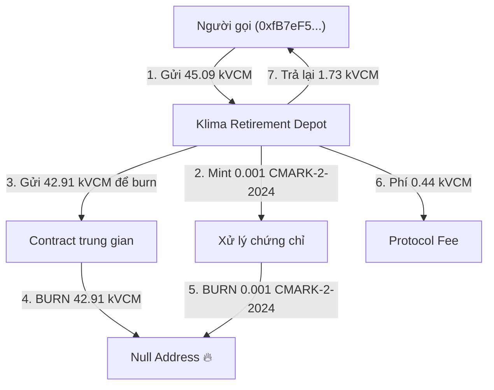

# Phân Tích Blockchain - Address & Transaction trên Base Chain

## 1. Tổng quan Address `0x7e73347d87fe9f00afbaafd19aa7f26dec72ffd5`

| Thông tin                | Chi tiết                                |
| ------------------------ | --------------------------------------- |
| **Loại**                 | Smart Contract (Verified)               |
| **Token Type**           | **ERC-20 Token**                        |
| **Tên Token**            | **CMARK-2-2024**                        |
| **Token Reputation**     | Unknown (chưa được xác minh danh tiếng) |
| **Holders**              | 1                                       |
| **Balance**              | $0 across 0 chains                      |
| **Tổng số Transactions** | 3                                       |

> [!IMPORTANT]
> Đây là một **smart contract ERC-20 token** có tên **CMARK-2-2024**, không phải là một ví thông thường.

---

## 2. Phân tích Transaction `0x994a6ec5c9...`

### Thông tin giao dịch chính

| Thông tin                | Chi tiết                                                                                   |
| ------------------------ | ------------------------------------------------------------------------------------------ |
| **Status**               | ✅ Success                                                                                 |
| **Block**                | 49,655,560                                                                                 |
| **Thời gian**            | Aug-07-2026 11:01:07 AM (UTC)                                                              |
| **From**                 | `0xfB7eF581B0338A31e47AA9770345b26D46BF0451`                                               |
| **To (Interacted With)** | `0x290e98e95dacE244c73376C0c39A4D53b22E34B6` - **Klima Protocol: Carbon Retirement Depot** |
| **Value**                | 0 ETH ($0.00)                                                                              |
| **Transaction Fee**      | 0.000008478614353906 ETH (~$0.02)                                                          |
| **Gas Price**            | 0.006 Gwei                                                                                 |
| **Method Called**        | `retireWithFee(tuple params)` - MethodID: `0x88921f3d`                                     |

### Token Transfers (7 lần chuyển token)

| #   | Token                                  | Số lượng     | From            | To                                 | Ghi chú                     |
| --- | -------------------------------------- | ------------ | --------------- | ---------------------------------- | --------------------------- |
| 1   | **kVCM** (Klima Protocol Carbon Units) | 45.089153... | `0xfB7eF581...` | `0x290e98e9...` (Retirement Depot) | Nạp token vào contract      |
| 2   | **CMARK-2-2024**                       | 0.001        | `0x1b597DA3...` | `0xdA0A793D...`                    | Chuyển chứng chỉ carbon     |
| 3   | **kVCM**                               | 42.913405... | `0x290e98e9...` | `0x1C242393...`                    | Chuyển để đốt               |
| 4   | **kVCM**                               | 42.913405... | `0x1C242393...` | `Null: 0x000...`                   | 🔥 **ĐỐT (BURN)**           |
| 5   | **CMARK-2-2024**                       | 0.001        | `0xdA0A793D...` | `Null: 0x000...`                   | 🔥 **ĐỐT (BURN)**           |
| 6   | **kVCM**                               | 0.441549...  | `0x290e98e9...` | `0xf624f9Fe...`                    | Phí protocol                |
| 7   | **kVCM**                               | 1.734198...  | `0x290e98e9...` | `0xfB7eF581...`                    | Tiền thừa trả lại người gọi |

---

## 3. Kết Luận: Đây CÓ PHẢI là giao dịch token không?

> [!IMPORTANT]
> **CÓ** - Đây **100% là giao dịch token**, cụ thể là một giao dịch **"Carbon Retirement"** (nghỉ hưu carbon / bù đắp carbon).

### Loại giao dịch cụ thể

Đây **KHÔNG phải** là giao dịch mua bán token thông thường. Đây là một **giao dịch nghỉ hưu tín chỉ carbon (Carbon Credit Retirement)** thuộc hệ sinh thái **Klima Protocol** trên Base chain.

### Giải thích chi tiết cơ chế

### Tóm tắt ý nghĩa

| Yếu tố            | Ý nghĩa                                                                                   |
| ----------------- | ----------------------------------------------------------------------------------------- |
| **kVCM**          | Klima Protocol Carbon Units - đại diện cho tín chỉ carbon                                 |
| **CMARK-2-2024**  | Token chứng chỉ carbon cụ thể (tại address `0x7e73347d...`)                               |
| **retireWithFee** | Hàm "nghỉ hưu" tín chỉ carbon - nghĩa là đốt bỏ vĩnh viễn token để xác nhận bù đắp carbon |
| **Burn (đốt)**    | Token gửi đến `0x000...` - bị hủy vĩnh viễn, không thể khôi phục                          |
| **Phí**           | ~1% kVCM trả cho protocol, tiền thừa trả lại người gọi                                    |

> [!NOTE]
> **Tóm lại**: Người dùng `0xfB7eF581...` đã sử dụng ~45 kVCM để "retire" (đốt bỏ vĩnh viễn) tín chỉ carbon thông qua Klima Protocol trên Base chain. Trong quá trình đó, cả kVCM và CMARK-2-2024 tokens đều bị **burn** (đốt), trả phí cho protocol, và tiền thừa được hoàn lại.

### Input Data

### Recording

