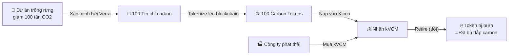
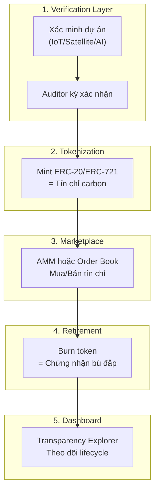

# Klima Protocol & Cách Xây Dựng Dự Án Carbon Credit

## 1. Klima Protocol là gì? (Giải thích dễ hiểu)

### Ví dụ thực tế

Hãy tưởng tượng **thị trường carbon** giống như một **chợ rau**:

| Thế giới thực                                                | Klima Protocol                                                                |
| ------------------------------------------------------------ | ----------------------------------------------------------------------------- |
| 🌳 Nông dân trồng rừng → được cấp "giấy chứng nhận giảm CO2" | Dự án môi trường → được cấp **tín chỉ carbon**                                |
| 📜 Giấy chứng nhận nằm trong tủ hồ sơ, khó mua bán           | Tín chỉ nằm trên registry truyền thống (Verra, Gold Standard) - kém minh bạch |
| 🏪 Klima = **sàn giao dịch online** cho giấy chứng nhận này  | Klima đưa tín chỉ lên **blockchain** → mua bán dễ, minh bạch                  |
| 💰 kVCM = "tiền chung" dùng trong chợ này                    | kVCM = đơn vị thanh toán cho mọi giao dịch carbon                             |

### kVCM là gì?

```
kVCM = Klima Voluntary Carbon Market
     = "Đồng tiền" dùng trong hệ sinh thái Klima
```

**Vai trò cụ thể:**

- 🔄 **Trung gian giao dịch**: Bạn muốn mua/bán tín chỉ carbon → dùng kVCM
- 📊 **Đơn vị định giá**: Mỗi loại tín chỉ carbon đều được đo bằng kVCM
- 🗳️ **Governance**: Nắm giữ kVCM = có quyền bỏ phiếu về quy tắc protocol
- 🔥 **Retirement**: Muốn "nghỉ hưu" tín chỉ carbon (bù đắp carbon) → đốt kVCM

### Cơ chế hoạt động (đơn giản)



---

## 2. Nếu muốn làm dự án carbon tương tự, có BẮT BUỘC dùng Klima không?

> [!IMPORTANT]
> **KHÔNG bắt buộc.** Bạn có **3 lựa chọn** với mức độ phức tạp khác nhau.

### Lựa chọn A: Dùng Klima Protocol (Dễ nhất)

**Giống như**: Bạn mở shop trên Shopee thay vì tự xây website

| Ưu điểm                                | Nhược điểm                        |
| -------------------------------------- | --------------------------------- |
| ✅ Hạ tầng sẵn có                      | ❌ Phụ thuộc vào Klima            |
| ✅ Liquidity pool có sẵn               | ❌ Phải tuân theo quy tắc của họ  |
| ✅ Cộng đồng người dùng có sẵn         | ❌ Phí protocol (dù hiện tại = 0) |
| ✅ Không cần xây smart contract từ đầu | ❌ Chỉ hoạt động trên Base chain  |

**Phù hợp khi**: Bạn muốn tập trung vào **dự án môi trường**, không muốn lo về công nghệ blockchain.

---

### Lựa chọn B: Dùng nền tảng khác (Trung bình)

Ngoài Klima, còn có các platform khác:

| Platform            | Đặc điểm                                                |
| ------------------- | ------------------------------------------------------- |
| **Toucan Protocol** | "Cầu nối" đưa tín chỉ từ Verra lên blockchain (Polygon) |
| **Carbonmark**      | Marketplace mua bán tín chỉ carbon tokenized            |
| **Moss.Earth**      | MCO2 token, tập trung vào bảo vệ rừng Amazon            |
| **Flowcarbon**      | GNT token, backed by carbon credits                     |
| **Regen Network**   | Cosmos-based, focus on ecological data                  |

---

### Lựa chọn C: Tự xây từ đầu (Khó nhất nhưng linh hoạt nhất)

**Giống như**: Bạn tự xây sàn thương mại điện tử thay vì bán trên Shopee

#### Bạn cần xây 5 module chính:



#### Chi tiết kỹ thuật:

| Module                      | Công nghệ                    | Mô tả                                                    |
| --------------------------- | ---------------------------- | -------------------------------------------------------- |
| **Smart Contract - Mint**   | Solidity + OpenZeppelin      | ERC-20 (fungible) hoặc ERC-1155 (mỗi tín chỉ riêng biệt) |
| **Smart Contract - Retire** | Solidity                     | Burn function + phát "Proof of Retirement"               |
| **Verification**            | IPFS/Filecoin                | Lưu trữ report MRV, chứng chỉ xác minh                   |
| **Marketplace**             | Uniswap V3 fork / custom AMM | Pool thanh khoản cho token                               |
| **Blockchain**              | Base / Polygon / Avalanche   | Layer-2 để phí thấp                                      |
| **Frontend**                | React/Next.js                | Dashboard minh bạch                                      |

---

## 3. So sánh 3 lựa chọn

| Tiêu chí      | 🅰️ Dùng Klima     | 🅱️ Dùng platform khác  | 🅲 Tự xây                |
| ------------- | ----------------- | ---------------------- | ----------------------- |
| **Độ khó**    | ⭐ Dễ             | ⭐⭐ Trung bình        | ⭐⭐⭐⭐⭐ Rất khó      |
| **Chi phí**   | Thấp              | Trung bình             | Cao (audit, dev, legal) |
| **Thời gian** | 1-2 tháng         | 2-4 tháng              | 6-12+ tháng             |
| **Linh hoạt** | Thấp              | Trung bình             | Rất cao                 |
| **Pháp lý**   | Klima lo          | Platform lo một phần   | Bạn tự lo 100%          |
| **Phù hợp**   | MVP, test ý tưởng | Cần customize vừa phải | Dự án lớn, dài hạn      |

---

## 4. Khuyến nghị cho bạn

> [!TIP]
> **Nếu mới bắt đầu**, hãy đi theo thứ tự:
>
> 1. **Phase 1**: Dùng Klima/Carbonmark để hiểu cơ chế → phát hành 1 batch tín chỉ thử
> 2. **Phase 2**: Khi đã hiểu rõ, xây marketplace riêng tích hợp API của Carbonmark
> 3. **Phase 3**: Tự xây toàn bộ infrastructure khi đã có user base

> [!WARNING]
> **Thách thức lớn nhất KHÔNG phải công nghệ** mà là:
>
> - 📋 **Pháp lý**: Token carbon được coi là gì theo luật Việt Nam? Chứng khoán? Hàng hóa?
> - 🌳 **Dự án thực**: Bạn cần có dự án giảm phát thải **thật** được tổ chức quốc tế (Verra, Gold Standard) xác minh
> - 🔍 **Chống gian lận**: "Double counting" (1 tín chỉ bán 2 lần) là vấn đề nghiêm trọng nhất
