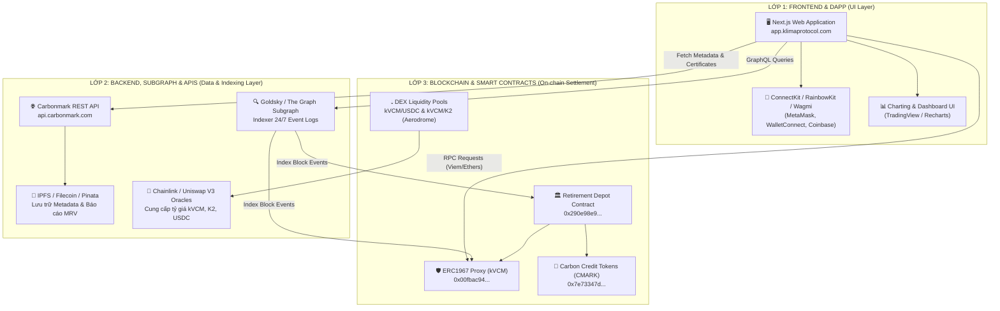

# Phân Tích Tổng Quan Kiến Trúc Hệ Thống Klima Protocol (System Architecture Overview)

> **Tài liệu Kỹ thuật (Technical Reference)**  
> **Mục đích:** Tổng quan kiến trúc 3 lớp (Frontend, Backend/Indexer, Smart Contracts) của Klima Protocol và định hướng ứng dụng cho **VNDAX Protocol**.

---

## 1. BỨC TRANH TOÀN CẢNH HỆ THỐNG KLIMA PROTOCOL

Klima Protocol (Klima 2.0) là một hệ sinh thái FinTech-Web3 lai, hoạt động trực tiếp trên **Base Chain** (Layer 2 của Ethereum). Kiến trúc hệ thống bao gồm 3 lớp chính:

---

## 2. TỔNG QUAN VỀ 3 LỚP HỆ THỐNG

### 2.1. Lớp Frontend (DApp UI)
- **Framework:** Next.js (React 18/19), TypeScript, TailwindCSS.
- **Web3 Provider:** Wagmi + Viem / ConnectKit / Ethers.js.
- **Quản lý Ví:** Tích hợp MetaMask, WalletConnect, Coinbase Wallet, Browser Extension Injected Wallets.
- **Trạng thái:** Quản lý State tập trung qua React Query (TanStack Query) để caching dữ liệu từ Subgraph và Blockchain RPC.

### 2.2. Lớp Backend & Indexer
- **Subgraph Indexer (Goldsky / The Graph):** Đọc toàn bộ các sự kiện `Transfer`, `CarbonRetired`, `Mint`, `Burn` từ Base chain theo thời gian thực và cấu trúc thành cơ sở dữ liệu GraphQL cho Frontend query.
- **Carbonmark API:** Cung cấp thông tin dự án, danh mục tiêu chuẩn (Verra, Gold Standard, Biochar...), dữ liệu chứng nhận và xuất file Chứng chỉ PDF cho người dùng sau khi retire.
- **IPFS Storage:** Lưu trữ file JSON Metadata của từng dự án carbon và bản chụp báo cáo MRV.

### 2.3. Lớp Blockchain (Base Chain)
- **Token chuẩn:**
  - `kVCM` (ERC-20 Upgradeable Proxy): Token đóng vai trò đơn vị định giá & thanh toán carbon chung.
  - `K2` (ERC-20 Governance Token): Token quản trị và chia sẻ lợi tức staking.
  - `CMARK-X-YYYY` (ERC-20 Carbon Project Tokens): Token chứng chỉ đại diện từng dự án cụ thể (Mint rồi Burn ngay).
- **Retirement Depot:** Smart contract trung tâm nhận lệnh `retireWithFee()`, điều khiển burn `kVCM`, mint/burn `CMARK` và chuyển phí protocol.

---

## 3. DANH MỤC TÀI LIỆU CHI TIẾT TRONG THƯ MỤC `system-klima/`

Toàn bộ phân tích chuyên sâu đã được tách thành các file chuyên biệt:

1. 📜 **[klima_frontend_dapp_analysis.md](klima_frontend_dapp_analysis.md)**: Phân tích kiến trúc Frontend, UI Component Layout, và Luồng kết nối ví MetaMask.
2. 🗄️ **[klima_backend_subgraph_analysis.md](klima_backend_subgraph_analysis.md)**: Phân tích hệ thống Backend, Subgraph Indexer, APIs, Oracles và IPFS.
3. 🔄 **[klima_current_user_flows.md](klima_current_user_flows.md)**: Phân tích các luồng nghiệp vụ hiện tại (Retire Carbon, Supply Carbon, Liquidity Staking, Wallet Connection, Allocate, My Activities).
4. ⚡ **[kvcm_blockchain_deepdive.md](kvcm_blockchain_deepdive.md)**: Phân tích chi tiết Mã nguồn Smart Contract `KVCM.sol` và luồng 7 bước giao dịch on-chain.
5. 🔧 **[klima_smart_contracts_suite.md](klima_smart_contracts_suite.md)**: Trọn bộ mã nguồn Solidity 4 Smart Contracts (KVCM, CMARK, RetirementDepot, K2Token) kèm thứ tự deploy và dependency.
6. 🚀 **[klima_deployment_testnet_guide.md](klima_deployment_testnet_guide.md)**: Hướng dẫn cấu hình Hardhat, deploy trọn bộ lên Testnet, và script test retire thực tế.
