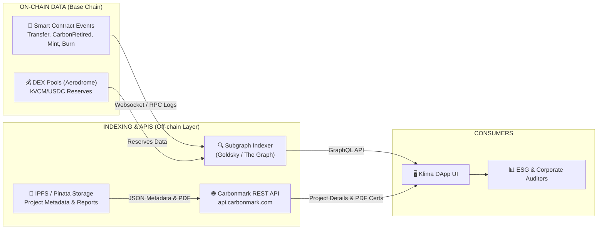

# Bóc Tách Kỹ Thuật Backend, Subgraph Indexer & APIs Klima Protocol

> **Tài liệu Kỹ thuật (Technical Reference)**  
> **Mục đích:** Phân tích hạ tầng dữ liệu off-chain, Subgraph Indexer (Goldsky/The Graph), REST APIs, Oracles giá và IPFS metadata của Klima Protocol để làm thiết kế chuẩn cho **VNDAX Backend Infrastructure**.

---

## 1. HẠ TẦNG DỮ LIỆU BACKEND KLIMA PROTOCOL

Dữ liệu của Klima Protocol không nằm hoàn toàn on-chain mà được xử lý qua mô hình **Hybrid Data Architecture**:



---

## 2. CHUYÊN SÂU VỀ SUBGRAPH INDEXER (THE GRAPH / GOLDSKY)

Subgraph đóng vai trò là "Bộ đọc dữ liệu 24/7", lắng nghe mọi block trên Base chain và biến các sự kiện Smart Contract thô thành dữ liệu dạng GraphQL có thể query tức thì.

### 2.1. Cấu Trúc Schema GraphQL Mẫu (`schema.graphql`)

```graphql
type CarbonRetirement @entity {
  id: ID! # Transaction Hash + Log Index
  beneficiaryAddress: Bytes! # Ví người bù trừ
  retrieverAddress: Bytes! # Ví thực hiện gọi hàm
  carbonTokenAddress: Bytes! # Địa chỉ vCAR/CMARK token
  amount: BigInt! # Số lượng (wei)
  feeAmount: BigInt! # Phí protocol
  projectID: String! # Mã dự án carbon
  vintage: String! # Năm phát hành (Vintage)
  timestamp: BigInt! # Thời gian block
  transactionHash: Bytes! # Mã băm giao dịch
}

type TokenBalance @entity {
  id: ID! # User Address + Token Address
  user: Bytes!
  token: Bytes!
  balance: BigInt!
  lastUpdatedBlock: BigInt!
}
```

### 2.2. Câu Truy Vấn GraphQL Mẫu (Frontend Query Dữ Liệu Retire)

```graphql
query GetUserRetirements($userAddress: Bytes!) {
  carbonRetirements(
    where: { beneficiaryAddress: $userAddress }
    orderBy: timestamp
    orderDirection: desc
  ) {
    id
    carbonTokenAddress
    amount
    feeAmount
    projectID
    vintage
    timestamp
    transactionHash
  }
}
```

---

## 3. CÁC API & LƯU TRỮ PHI TẬP TRUNG (IPFS)

### 3.1. Carbonmark REST API (`api.carbonmark.com`)
- **Vai trò:** Cung cấp thông tin hiển thị phong phú (Rich Metadata) cho từng dự án carbon mà blockchain không lưu được do chi phí gas cao.
- **Endpoints chính:**
  - `GET /projects`: Lấy danh sách các dự án carbon được phân loại theo quốc gia, tiêu chuẩn (Verra, Gold Standard, Biochar), và phương pháp luận.
  - `GET /projects/{id}`: Chi tiết dự án, tọa độ địa lý, báo cáo MRV, diện tích rừng/nhà máy.
  - `GET /certificates/{id}`: Trích xuất thông tin chứng chỉ bù trừ chính thức (PDF) kèm mã QR xác minh.

### 3.2. Cấu Trúc IPFS Metadata (Dự Án Carbon)
Mỗi lô dự án khi được token hóa sẽ đẩy một file `metadata.json` lên IPFS:

```json
{
  "name": "Long Hưu Blue Carbon Mangrove Project 2026",
  "description": "Blue Carbon sequestration project in Long An / Tay Ninh, Vietnam under Verra VM0033 methodology.",
  "image": "ipfs://QmXxx.../thumbnail.jpg",
  "external_url": "https://vndax.com/projects/long-huu-2026",
  "attributes": [
    { "trait_type": "Project ID", "value": "LongHuu-BC-2026" },
    { "trait_type": "Country", "value": "Vietnam" },
    { "trait_type": "Methodology", "value": "Verra VM0033" },
    { "trait_type": "Vintage", "value": "2026" },
    { "trait_type": "Area", "value": "100 ha" },
    { "trait_type": "MRV Report Hash", "value": "0xa1b2c3d4e5f6..." }
  ]
}
```

---

## 4. BÀI HỌC VÀ THIẾT KẾ CHO BACKEND VNDAX PROTOCOL

1. **Xây Dựng Subgraph Riêng Cho BNB Smart Chain:**
   - VNDAX cần triển khai một **Custom Subgraph** (dùng dịch vụ Goldsky hoặc tự host Graph Node) để index 3 hợp đồng: `VNDAXBatchNFT.sol`, `VNDAXCarbonToken.sol`, và `VNDAXRetirement.sol`.
   - Giúp Frontend VNDAX hiển thị lịch sử giao dịch và số dư tức thì mà không cần RPC polling.

2. **Dịch Vụ Worker Tự Động Nối Liền On-chain & Off-chain:**
   - Xây dựng một **Event Listener Microservice** (viết bằng Golang hoặc Node.js).
   - Khi lắng nghe được sự kiện `CarbonRetired` từ hợp đồng `VNDAXRetirement.sol`:
     1. Worker tự động gọi API Verra Registry để nhấn nút **Retire Off-chain** tương ứng.
     2. Worker tự động render file **Chứng chỉ PDF Bù trừ Carbon** (chứa TX Hash on-chain + logo doanh nghiệp).
     3. Gửi email thông báo chứng chỉ PDF cho kế toán doanh nghiệp.
