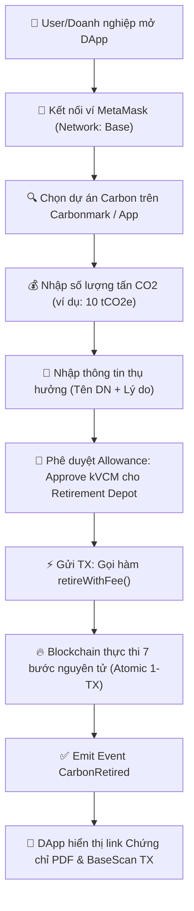
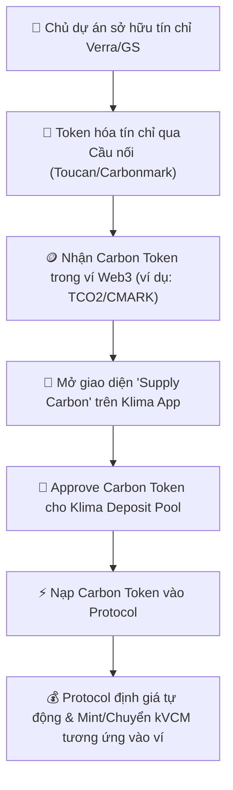
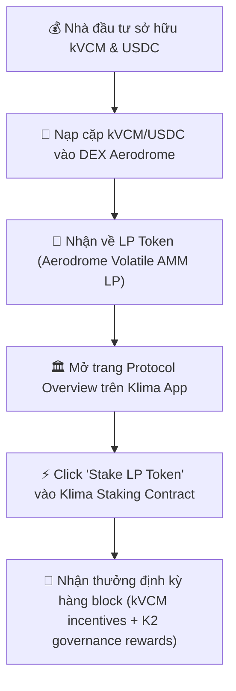
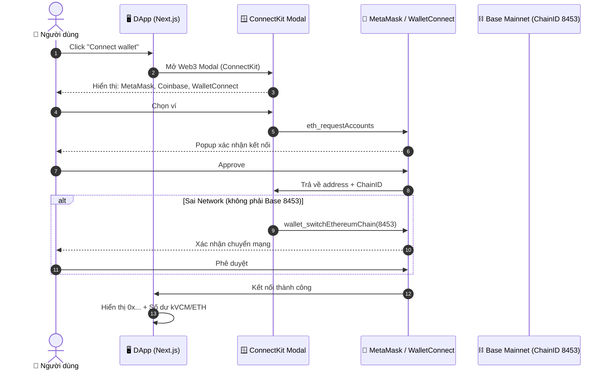
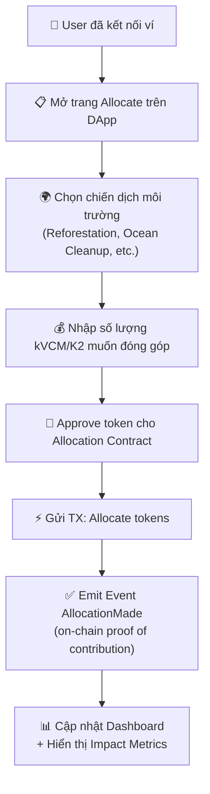
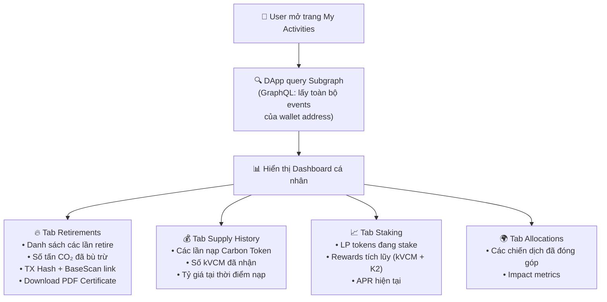
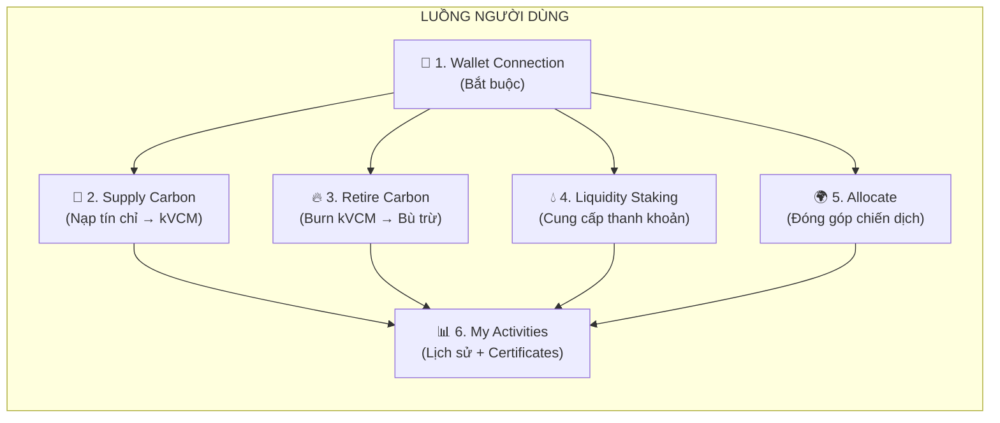

# Bóc Tách Chi Tiết Các Luồng Nghiệp Vụ Hiện Tại (Current User Flows) Klima Protocol

> **Tài liệu Kỹ thuật (Technical Reference)**  
> **Mục đích:** Phân tích từng luồng trải nghiệm người dùng (End-to-End User Flows) trên Klima Protocol hiện tại và so sánh ứng dụng vào **VNDAX Protocol**.

---

## 1. LUỒNG 1: RETIRE CARBON (BÙ TRỪ CARBON VĨNH VIỄN)

Luồng này phục vụ các doanh nghiệp hoặc cá nhân có nhu cầu tiêu hủy tín chỉ carbon để làm báo cáo ESG / CBAM.

### Bước Chi Tiết:

1. **Kiểm tra điều kiện:** Người dùng có đủ `kVCM` và một ít `ETH` làm phí gas trên Base chain.
2. **Ký Approve (Allowance):** Nếu lần đầu giao dịch, ví MetaMask bật popup yêu cầu Approve cho hợp đồng `Retirement Depot` (`0x290e98e9...`) được chi xài số `kVCM` tương ứng.
3. **Thực thi `retireWithFee`:** Ví gọi hàm với tham số chứa địa chỉ ví thụ hưởng, mã dự án, và lý do bù trừ.
4. **Kết quả:** `kVCM` bị burn, `CMARK` mint-then-burn, sự kiện on-chain được tạo lập vĩnh viễn.

---

## 2. LUỒNG 2: SUPPLY CARBON (NẠP TÍN CHỈ CARBON ĐỔI LẤY kVCM)

Luồng này phục vụ các nhà phát triển dự án carbon (Project Developers) hoặc các chủ sở hữu tín chỉ carbon gốc muốn đưa tín chỉ lên chain lấy thanh khoản.

### Bước Chi Tiết:

1. **Yêu cầu đầu vào:** Người dùng có sẵn token đại diện tín chỉ carbon trong ví Web3.
2. **Xác định tỷ giá (Pricing):** Protocol tính toán tỷ giá đổi từ Carbon Token sang `kVCM` dựa trên chất lượng dự án, vintage và pool thanh khoản.
3. **Thực thi:** Carbon Token được nạp vào kho lưu trữ (Treasury) của Klima, và người nạp nhận về `kVCM` có thể mua bán tự do trên DEX.

---

## 3. LUỒNG 3: LIQUIDITY STAKING & INCENTIVES

Luồng này dành cho các nhà đầu tư DeFi cung cấp thanh khoản cho cặp token carbon.

---

## 4. LUỒNG 4: KẾT NỐI VÍ (WALLET CONNECTION)

Luồng này là bước đầu tiên bắt buộc trước khi người dùng có thể thực hiện bất kỳ hành động on-chain nào.

### Bước Chi Tiết:

1. **Web3 Provider Stack:** Wagmi + Viem + ConnectKit (hỗ trợ MetaMask, WalletConnect, Coinbase Wallet).
2. **Network Check:** Nếu ví đang ở mạng khác (Ethereum Mainnet, Polygon...), DApp tự động yêu cầu chuyển sang Base (ChainID 8453).
3. **State Management:** Sau khi kết nối, TanStack Query (React Query) tự động fetch balance kVCM, K2, ETH và cache để hiển thị tức thì.
4. **Gasless Approval (EIP-2612):** kVCM hỗ trợ `permit()` - người dùng ký off-chain thay vì tốn gas gọi `approve()`.

---

## 5. LUỒNG 5: ALLOCATE (PHÂN BỔ VỐN CHO CHIẾN DỊCH MÔI TRƯỜNG)

Luồng này cho phép người dùng hoặc doanh nghiệp đóng góp vốn/carbon cho các chiến dịch môi trường cụ thể trên nền tảng.

### Bước Chi Tiết:

1. **Mục đích:** Khác với Retire (tiêu hủy vĩnh viễn), Allocate là **cam kết đóng góp** vốn cho một mục tiêu môi trường cụ thể mà không nhất thiết burn token ngay.
2. **Impact Tracking:** Sau khi allocate, DApp hiển thị số liệu tác động (tấn CO₂ đã hỗ trợ, số dự án được tài trợ).
3. **Phân biệt với Retire:** Retire = burn vĩnh viễn (bù trừ carbon). Allocate = cam kết vốn (hỗ trợ dự án xanh, có thể kèm staking reward).

---

## 6. LUỒNG 6: MY ACTIVITIES (LỊCH SỬ GIAO DỊCH CÁ NHÂN)

Luồng này là trang tổng hợp toàn bộ hoạt động của người dùng trên Klima Protocol.

### Dữ Liệu Hiển Thị:

| Tab                | Nguồn dữ liệu                            | Thông tin chính                                       |
| ------------------ | ---------------------------------------- | ----------------------------------------------------- |
| **Retirements**    | Subgraph (`CarbonRetired` events)        | TX Hash, số lượng tCO₂e, dự án, ngày, PDF Certificate |
| **Supply History** | Subgraph (`Transfer` events to Protocol) | Carbon Token nạp, kVCM nhận, tỷ giá                   |
| **Staking**        | On-chain query (Staking Contract)        | LP balance, pending rewards, APR                      |
| **Allocations**    | Subgraph (`AllocationMade` events)       | Chiến dịch, số vốn, impact metrics                    |

### Retirement Certificate PDF:

- Sau mỗi lần retire, Carbonmark API tự động generate **PDF chứng chỉ bù trừ** chứa:
  - Tên doanh nghiệp/cá nhân thụ hưởng
  - Số lượng tCO₂e đã bù trừ
  - Dự án carbon gốc (project ID, vintage)
  - TX Hash on-chain (link BaseScan)
  - QR Code xác minh (scan để verify on-chain)

---

## 7. TỔNG HỢP: 6 LUỒNG NGHIỆP VỤ KLIMA PROTOCOL

| Luồng                 | Ai dùng              | Tác động on-chain                 | Kết quả                                   |
| --------------------- | -------------------- | --------------------------------- | ----------------------------------------- |
| **Wallet Connection** | Tất cả               | Không                             | Kết nối ví, sẵn sàng giao dịch            |
| **Supply Carbon**     | Project Developers   | Nạp Carbon Token → Nhận kVCM      | Tăng nguồn cung carbon on-chain           |
| **Retire Carbon**     | Doanh nghiệp/Cá nhân | Burn kVCM + CMARK (7 bước atomic) | Bù trừ carbon vĩnh viễn + PDF Certificate |
| **Liquidity Staking** | DeFi Investors       | Stake LP Token → Nhận rewards     | Tăng thanh khoản kVCM/USDC                |
| **Allocate**          | Nhà tài trợ/DN ESG   | Cam kết vốn cho chiến dịch        | Hỗ trợ dự án xanh + Impact report         |
| **My Activities**     | Tất cả               | Không (chỉ đọc)                   | Xem lịch sử + tải PDF Certificates        |

---

## 8. BÀI HỌC VÀ SO SÁNH QUY TRÌNH CHO VNDAX PROTOCOL

### Bảng So Sánh Luồng Nghiệp Vụ Klima vs. VNDAX

| Luồng Nghiệp Vụ             | Klima Protocol (Hiện tại)                                        | VNDAX Protocol (Thiết Kế)                                                                                     |
| --------------------------- | ---------------------------------------------------------------- | ------------------------------------------------------------------------------------------------------------- |
| **Kết nối ví**              | ConnectKit + MetaMask (permissionless)                           | **Social Login + Account Abstraction (ERC-4337)** - DN đăng nhập bằng Email/Google, không cần MetaMask        |
| **Tạo Nguồn Cung (Supply)** | Token hóa qua Toucan → Nạp vào Klima lấy `kVCM` (permissionless) | Admin ký gửi Verra → **Freeze off-chain** → Multi-sig **Mint NFT & vCAR** trực tiếp trên VNDAX (permissioned) |
| **Giao Dịch (Trade)**       | Mua/bán `kVCM` tự do trên DEX Aerodrome (`kVCM/USDC`)            | Mua/bán `vCAR` trực tiếp trên **VNDAX Marketplace Order Book** bằng USDT/VND                                  |
| **Bù Trừ (Retire)**         | Gọi `retireWithFee()` → Burn `kVCM` & `CMARK` 100% on-chain      | Gọi `retireCarbon()` → **Burn `vCAR` on-chain** + **Retire Verra off-chain** + Xuất Chứng chỉ PDF             |
| **Bằng Chứng (Proof)**      | CMARK mint→burn Event + Carbonmark PDF                           | `CarbonRetired` Event + NFT BEP-721 Metadata + Chứng chỉ PDF tuân thủ NĐ 06/2022                              |
| **Staking/Liquidity**       | Stake LP Token (kVCM/USDC, kVCM/K2) → kVCM + K2 rewards          | Stake **CAR Token** vào ReFi DAO → Green Yield từ doanh thu sàn                                               |
| **Allocate**                | Đóng góp vốn cho chiến dịch môi trường                           | Tương đương: Vote + Fund dự án xanh qua DAO Governance (CAR token)                                            |
| **Lịch sử (Activities)**    | Subgraph GraphQL → Dashboard + PDF Certificates                  | Event Listener → Dashboard + PDF Certificates + Báo cáo ESG/CBAM format                                       |

### Khuyên Dùng Cho CTO VNDAX:

- **Giữ nguyên** luồng **Retire Carbon đơn giản 3 bước** của Klima vì giao diện này cực kỳ thân thiện với doanh nghiệp B2B.
- **Loại bỏ** luồng **Supply Carbon tự do** của Klima. VNDAX nên dùng luồng **Freeze-then-Mint có kiểm duyệt bởi Admin/Multi-sig** để tuân thủ pháp lý Việt Nam và chống tẩy xanh (Anti-Greenwashing).
- **Thay ConnectKit bằng Account Abstraction** - DN Việt Nam không quen MetaMask, cần Social Login (Email/Google) + ký giao dịch ngầm.
- **Xây Subgraph riêng cho BNB Chain** - index `VNDAXRetirement.sol` events để hiển thị lịch sử real-time, không cần RPC polling.
- **PDF Certificate format** - thêm trường tuân thủ NĐ 06/2022 và CBAM EU để DN có thể nộp trực tiếp cho cơ quan quản lý.
