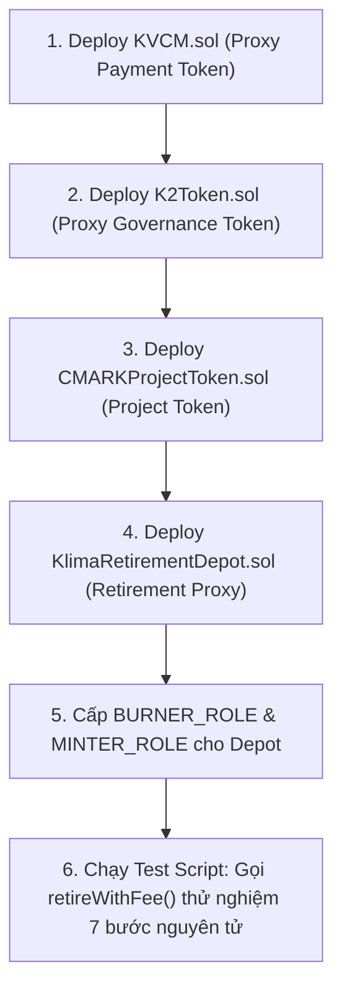

# Hướng Dẫn Cấu Hình & Deploy Trọn Bộ Klima Protocol Lên Testnet

> **Tài liệu Kỹ thuật chính thức (Official Technical Specification)**  
> **Blockchain Target:** BNB Smart Chain Testnet (ChainID: 97) hoặc Base Sepolia Testnet  
> **Công cụ:** Hardhat, @openzeppelin/hardhat-upgrades, Ethers.js.

---

## 1. MÔ TẢ QUY TRÌNH DEPLOY & CHẠY GIAO DỊCH TEST



---

## 2. FILE CẤU HÌNH HARDHAT (`hardhat.config.js`)

```javascript
require("@nomicfoundation/hardhat-toolbox");
require("@openzeppelin/hardhat-upgrades");
require("dotenv").config();

const PRIVATE_KEY = process.env.PRIVATE_KEY || "0x0000000000000000000000000000000000000000000000000000000000000001";

module.exports = {
  solidity: {
    version: "0.8.28",
    settings: {
      optimizer: {
        enabled: true,
        runs: 200,
      },
    },
  },
  networks: {
    bscTestnet: {
      url: "https://data-seed-prebsc-1-s1.binance.org:8545/",
      chainId: 97,
      accounts: [PRIVATE_KEY],
    },
  },
};
```

---

## 3. SCRIPT DEPLOY TRỌN BỘ KLIMA (`scripts/deploy_klima.js`)

```javascript
const { ethers, upgrades } = require("hardhat");

async function main() {
  const [deployer] = await ethers.getSigners();
  console.log("================================------------------");
  console.log("Deploying KLIMA PROTOCOL with account:", deployer.address);
  console.log("Balance:", (await ethers.provider.getBalance(deployer.address)).toString());
  console.log("================================------------------");

  // 1. Deploy KVCM Proxy
  console.log("\n1. Deploying KVCM Token Proxy...");
  const KVCM = await ethers.getContractFactory("KVCM");
  const kvcm = await upgrades.deployProxy(
    KVCM,
    ["Klima Voluntary Carbon Market Token", "kVCM", ethers.parseEther("1000000"), deployer.address],
    { kind: "uups" }
  );
  await kvcm.waitForDeployment();
  const kvcmAddress = await kvcm.getAddress();
  console.log("✅ KVCM Proxy deployed to:", kvcmAddress);

  // 2. Deploy K2 Token Proxy
  console.log("\n2. Deploying K2 Governance Token Proxy...");
  const K2Token = await ethers.getContractFactory("K2Token");
  const k2 = await upgrades.deployProxy(
    K2Token,
    [deployer.address, ethers.parseEther("500000")],
    { kind: "uups" }
  );
  await k2.waitForDeployment();
  const k2Address = await k2.getAddress();
  console.log("✅ K2 Token Proxy deployed to:", k2Address);

  // 3. Deploy CMARK Project Token
  console.log("\n3. Deploying CMARK Project Token (CMARK-2-2024)...");
  const CMARKProjectToken = await ethers.getContractFactory("CMARKProjectToken");
  const cmark = await CMARKProjectToken.deploy(
    "Carbonmark Carbon Credit 2024",
    "CMARK-2-2024",
    "CMARK-PROJECT-002",
    2024,
    deployer.address,
    deployer.address
  );
  await cmark.waitForDeployment();
  const cmarkAddress = await cmark.getAddress();
  console.log("✅ CMARK Project Token deployed to:", cmarkAddress);

  // 4. Deploy KlimaRetirementDepot Proxy
  console.log("\n4. Deploying KlimaRetirementDepot Proxy...");
  const KlimaRetirementDepot = await ethers.getContractFactory("KlimaRetirementDepot");
  const feeWallet = deployer.address; // Tạm dùng ví deployer nhận phí
  const feeBps = 100; // 1.00% fee
  const depot = await upgrades.deployProxy(
    KlimaRetirementDepot,
    [deployer.address, kvcmAddress, feeWallet, feeBps],
    { kind: "uups" }
  );
  await depot.waitForDeployment();
  const depotAddress = await depot.getAddress();
  console.log("✅ KlimaRetirementDepot Proxy deployed to:", depotAddress);

  // 5. Gán phân quyền BURNER_ROLE cho Depot trên KVCM và CMARK
  console.log("\n5. Granting Roles to Retirement Depot...");
  const BURNER_ROLE = await kvcm.BURNER_ROLE();
  await (await kvcm.grantRole(BURNER_ROLE, depotAddress)).wait();

  const CMARK_MINTER_ROLE = await cmark.MINTER_ROLE();
  const CMARK_BURNER_ROLE = await cmark.BURNER_ROLE();
  await (await cmark.grantRole(CMARK_MINTER_ROLE, depotAddress)).wait();
  await (await cmark.grantRole(CMARK_BURNER_ROLE, depotAddress)).wait();
  console.log("✅ Roles granted successfully!");

  console.log("\n================================------------------");
  console.log("🎉 KLIMA PROTOCOL DEPLOYMENT COMPLETE!");
  console.log("================================------------------");
  console.log("KVCM Proxy:             ", kvcmAddress);
  console.log("K2 Proxy:               ", k2Address);
  console.log("CMARK Project Token:    ", cmarkAddress);
  console.log("KlimaRetirementDepot:   ", depotAddress);
  console.log("================================------------------");
}

main()
  .then(() => process.exit(0))
  .catch((error) => {
    console.error(error);
    process.exit(1);
  });
```

---

## 4. SCRIPT CHẠY TEST LẦN RETIRE THỰC TẾ (`scripts/test_retire.js`)

```javascript
const { ethers } = require("hardhat");

async function main() {
  const [user] = await ethers.getSigners();
  console.log("Simulating Klima Carbon Retirement with account:", user.address);

  // Địa chỉ các contract đã deploy
  const kvcmAddress = "DEPLOYED_KVCM_PROXY_ADDRESS";
  const cmarkAddress = "DEPLOYED_CMARK_ADDRESS";
  const depotAddress = "DEPLOYED_DEPOT_PROXY_ADDRESS";

  const kvcm = await ethers.getContractAt("KVCM", kvcmAddress);
  const depot = await ethers.getContractAt("KlimaRetirementDepot", depotAddress);

  // Lượng carbon muốn retire: 1 unit (0.001 tCO2e)
  const amountToRetire = 1;
  const maxKvcmAmount = ethers.parseEther("100"); // Gửi dư để nhận refund

  console.log("Approve kVCM for Depot...");
  await (await kvcm.approve(depotAddress, maxKvcmAmount)).wait();

  console.log("Calling retireWithFee()...");
  const tx = await depot.retireWithFee(
    cmarkAddress,
    amountToRetire,
    maxKvcmAmount,
    "Doanh Nghiệp XYZ Vietnam",
    "Báo cáo ESG Bù trừ Carbon 2026"
  );
  const receipt = await tx.wait();
  console.log("✅ Retirement Transaction Successful!");
  console.log("TX Hash:", receipt.hash);
}

main().catch(console.error);
```

---

## 5. KIỂM TRA SAU DEPLOY (POST-DEPLOY VERIFICATION)

Sau khi deploy và chạy test retire, cần verify:

```bash
# 1. Kiểm tra role assignment
npx hardhat console --network bscTestnet
> const kvcm = await ethers.getContractAt("KVCM", "KVCM_ADDRESS");
> await kvcm.hasRole(await kvcm.BURNER_ROLE(), "DEPOT_ADDRESS");
# → phải trả về true

# 2. Kiểm tra balance sau retire
> const balance = await kvcm.balanceOf("USER_ADDRESS");
# → balance phải giảm đúng = kvcmBurned + feeAmount

# 3. Kiểm tra event CarbonRetired
# Xem trên BSCScan Testnet → Tab "Events" của TX Hash
```

### Checklist Deploy Cho CTO:

| Bước | Xác nhận | Kết quả mong đợi |
|------|----------|-------------------|
| 1. KVCM Proxy deploy | `kvcm.name()` = "Klima Voluntary Carbon Market Token" | ✅ |
| 2. K2 Proxy deploy | `k2.name()` = "Klima Governance Token v2" | ✅ |
| 3. CMARK deploy | `cmark.projectId()` = "CMARK-PROJECT-002" | ✅ |
| 4. Depot deploy | `depot.kvcmToken()` = KVCM address | ✅ |
| 5. BURNER_ROLE on KVCM → Depot | `kvcm.hasRole(BURNER_ROLE, depot)` = true | ✅ |
| 6. MINTER_ROLE on CMARK → Depot | `cmark.hasRole(MINTER_ROLE, depot)` = true | ✅ |
| 7. Test retireWithFee() | TX success + CarbonRetired event emitted | ✅ |
| 8. Verify kVCM burned | User balance giảm, Null address nhận token | ✅ |
| 9. Verify CMARK mint→burn | CMARK totalSupply = 0 (mint rồi burn ngay) | ✅ |
| 10. Verify fee | feeWallet balance tăng đúng 1% | ✅ |

> [!TIP]
> **Áp dụng cho VNDAX:** Thay `bscTestnet` bằng BNB Smart Chain Testnet (ChainID 97), thay 4 contracts Klima bằng bộ VNDAX (`VNDAXBatchNFT.sol`, `VNDAXCarbonToken.sol`, `VNDAXTokenFactory.sol`, `VNDAXRetirement.sol`). Flow deploy tương tự: deploy token contracts trước → deploy Retirement contract → gán roles → test retire.
