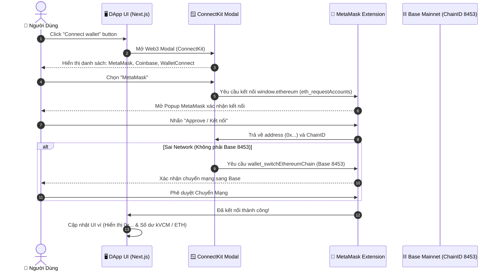

# Bóc Tách Kỹ Thuật Frontend & DApp UI Klima Protocol

> **Tài liệu Kỹ thuật (Technical Reference)**  
> **Mục đích:** Phân tích chi tiết kiến trúc Frontend, UI/UX Layout, thư viện Web3, và luồng kết nối ví MetaMask trên `app.klimaprotocol.com` để làm tham chiếu cho **VNDAX DApp**.

---

## 1. TECH STACK FRONTEND

DApp của Klima Protocol (`app.klimaprotocol.com`) được xây dựng trên bộ công nghệ hiện đại:

| Thành phần | Công nghệ / Thư viện | Vai trò & Chức năng |
|------------|----------------------|---------------------|
| **Core Framework** | Next.js (App Router / Pages Router) | Server-Side Rendering (SSR) & Static Site Generation (SSG) tối ưu SEO & tốc độ tải trang. |
| **Language** | TypeScript | Kiểm soát kiểu dữ liệu nghiêm ngặt cho ABI, BigNumber và API Response. |
| **Styling** | TailwindCSS + CSS Modules / Emotion | Thiết kế giao diện hiện đại, tối ưu giao diện Dark/Light mode và Responsive Layout. |
| **Web3 Provider** | Wagmi + Viem / ConnectKit / RainbowKit | Kết nối ví Web3, quản lý trạng thái Provider, Sign Message, Send Transaction. |
| **State & Data Fetching** | TanStack Query (React Query) | Caching dữ liệu RPC, tự động refetch balance, quản lý pending transaction state. |
| **UI Components** | Radix UI / Headless UI | Dialog Modal, Tooltips, Tabs Component tiêu chuẩn accessiblity. |

---

## 2. PHÂN TÍCH GIAO DIỆN & UI COMPONENT LAYOUT

Giao diện DApp Klima gồm 5 trang màn hình chính:

### 2.1. Protocol Overview (Dashboard Tổng Quan)
- **Top Metrics Cards:**
  - **kVCM TVL:** Hiển thị tổng lượng `kVCM` trong protocol (ví dụ: 9,150,501 kVCM ~ $208,686.32 USD).
  - **kVCM Price:** Tỷ giá `kVCM/USDC` thời gian thực (ví dụ: $0.0228 USD).
  - **K2 TVL & Price:** TVL và giá của đồng Token Governance `K2` ($0.0142 USD).
- **Liquidity Pools Section:**
  - Hiển thị thông số 2 pool thanh khoản chính trên DEX Aerodrome: `kVCM/USDC` ($7.08k TVL, APR incentives) và `kVCM/K2` ($30.87k TVL).
  - Cung cấp nút `Deposit` (mở DEX) và `Stake` (nạp LP token vào Klima contract).
- **Carbon Market Preview:** Nút chuyển đổi nhanh giữa 2 luồng chính `Retire Carbon` và `Supply Carbon`.

### 2.2. Retire Carbon (Luồng Bù Trừ)
- **Visual Process Steps (3 bước trực quan):**
  1. `Your kVCM`: Kiểm tra số dư `kVCM` sẵn có trong ví MetaMask.
  2. `Retire credits`: Chọn loại dự án carbon (Biochar, Blue Carbon, Forestry...) và nhập số lượng tấn CO₂ muốn bù trừ.
  3. `Climate impact`: Tạo bằng chứng cryptographic (Proof-of-Retirement) và phát hành chứng chỉ PDF qua Carbonmark.

### 2.3. Supply Carbon (Luồng Nạp Carbon Đổi lấy kVCM)
- **Process Flow:**
  1. `Your carbon credits`: Nhận diện các token carbon sẵn có trong ví Web3 (ví dụ: TCO2, BCT, CMARK).
  2. `Supply to protocol`: Chọn lớp tín chỉ carbon và số lượng muốn nạp vào protocol.
  3. `Receive kVCM`: Nhận lại `kVCM` theo tỷ giá thị trường tự động (Market-driven pricing).

### 2.4. Allocate & My Activities
- **Allocate:** Giao diện cho phép người dùng hoặc doanh nghiệp phân bổ vốn hoặc đóng góp carbon cho các chiến dịch môi trường.
- **My Activities:** Lịch sử toàn bộ các giao dịch nạp, rút, stake, và các chứng chỉ `Retirement Certificate` cá nhân (kèm TX Hash BaseScan).

---

## 3. LUỒNG KẾT NỐI VÍ METAMASK (WALLETS CONNECTION FLOW)



### Código Chi Tiết Luồng Kết Nối Ví (Mẫu Wagmi + ConnectKit)

```typescript
// AppProvider.tsx
import { WagmiConfig, createConfig, configureChains } from 'wagmi';
import { base } from 'wagmi/chains';
import { publicProvider } from 'wagmi/providers/public';
import { ConnectKitProvider, getDefaultConfig } from 'connectkit';

const { chains, publicClient } = configureChains([base], [publicProvider()]);

const config = createConfig(
  getDefaultConfig({
    appName: 'VNDAX Protocol DApp',
    walletConnectProjectId: 'YOUR_PROJECT_ID',
    chains,
    publicClient,
  })
);

export const Web3Provider = ({ children }: { children: React.ReactNode }) => {
  return (
    <WagmiConfig config={config}>
      <ConnectKitProvider theme="auto">
        {children}
      </ConnectKitProvider>
    </WagmiConfig>
  );
};
```

---

## 4. BÀI HỌC VÀ KHUYẾN NGHỊ THIẾT KẾ CHO FRONTEND VNDAX DAPP

1. **Thiết Kế Đơn Giản Hóa Cho Doanh Nghiệp (B2B):**
   - Không nên bắt người dùng B2B làm quá nhiều thao tác Web3 phức tạp.
   - VNDAX nên tích hợp **Social Login / Account Abstraction (ERC-4337)** để doanh nghiệp có thể đăng nhập bằng Email/Google và ký giao dịch ngầm, không bắt buộc họ phải tự cài MetaMask nếu họ chưa quen.

2. **UI Trực Quan Cho Luồng Retire Carbon:**
   - Học tập Klima ở cách chia rõ 3 bước (Ví -> Chọn Dự Án -> Nhận Chứng Chỉ).
   - Ngay sau khi bấm Retire, giao diện hiển thị ngay **Preview Bằng Chứng Certificate PDF** với mã Hash QR code để doanh nghiệp tải về nộp báo cáo ESG / CBAM.
