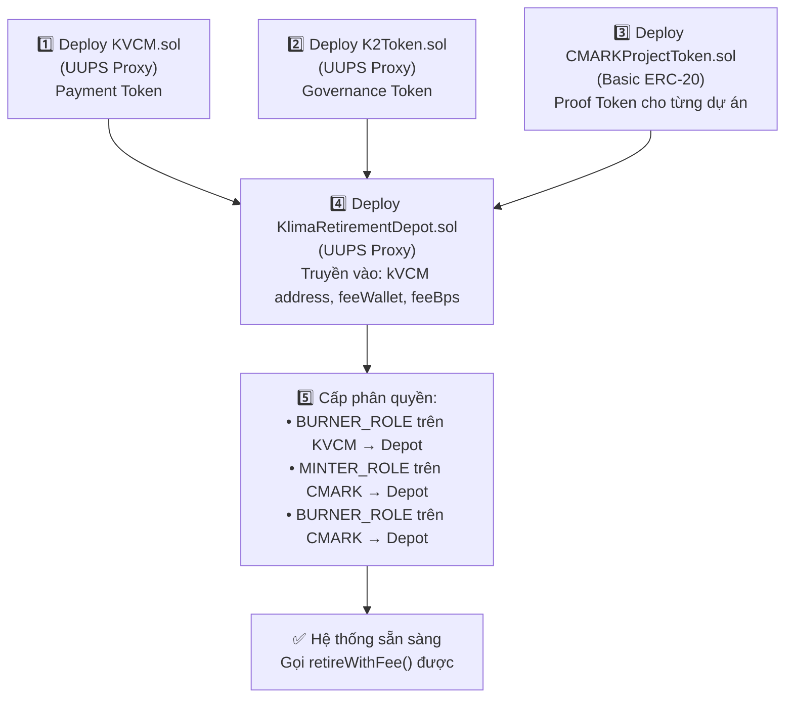

# Trọn Bộ Mã Nguồn Smart Contracts Klima Protocol (Full Contract Suite)

> **Tài liệu Kỹ thuật chính thức (Official Technical Specification)**  
> **Mục đích:** Cung cấp 100% mã nguồn Solidity của bộ hợp đồng Klima Protocol (`kVCM`, `CMARK`, `RetirementDepot`, `K2Token`) để biên dịch và deploy hệ thống Klima Protocol lên Testnet.

---

## 1. TỔNG QUAN BỘ SMART CONTRACTS KLIMA PROTOCOL

Để vận hành 100% hệ sinh thái Klima Protocol on-chain, hệ thống bao gồm 4 hợp đồng cốt lõi:

| Contract                          | Chuẩn Solidity                           | Vai trò trong Klima Protocol                                                                                      |
| --------------------------------- | ---------------------------------------- | ----------------------------------------------------------------------------------------------------------------- |
| **1. `KVCM.sol`**                 | ERC-20 (UUPS Upgradeable)                | **Token Thanh toán Carbon (`kVCM`)**: Token thanh toán chung, có phân quyền `MINTER_ROLE` và `BURNER_ROLE`.       |
| **2. `CMARKProjectToken.sol`**    | ERC-20 (Basic Burnable)                  | **Token Dự án Carbon (`CMARK-X-YYYY`)**: Token đại diện 1 dự án & vintage cụ thể (Mint rồi Burn ngay khi retire). |
| **3. `KlimaRetirementDepot.sol`** | Contract (Upgradeable / ReentrancyGuard) | **Bộ điều phối Bù trừ (`Retirement Depot`)**: Chứa hàm `retireWithFee()` thực thi luồng 7 bước nguyên tử.         |
| **4. `K2Token.sol`**              | ERC-20 (Upgradeable)                     | **Token Quản trị & Staking (`K2`)**: Token chia sẻ lợi tức staking protocol.                                      |

---

## 1B. THỨ TỰ DEPLOY & DEPENDENCY GIỮA 4 CONTRACTS



**Dependency Map:**

| Contract                     | Phụ thuộc vào                                 | Ai cấp quyền cho nó                         |
| ---------------------------- | --------------------------------------------- | ------------------------------------------- |
| **KVCM.sol**                 | Không phụ thuộc (deploy đầu tiên)             | Admin gán MINTER/BURNER/UPGRADER ban đầu    |
| **K2Token.sol**              | Không phụ thuộc (deploy song song với KVCM)   | Admin gán MINTER/UPGRADER                   |
| **CMARKProjectToken.sol**    | Không phụ thuộc (deploy mỗi khi có dự án mới) | Admin + Depot cần MINTER_ROLE + BURNER_ROLE |
| **KlimaRetirementDepot.sol** | Cần address KVCM + feeWallet                  | Admin gán BURNER_ROLE trên KVCM cho Depot   |

> [!IMPORTANT]
> **Thứ tự quan trọng:** Depot phải được deploy **sau** KVCM và CMARK, vì constructor cần `kvcmToken` address. Sau deploy, Admin **phải** gán `BURNER_ROLE` trên KVCM cho Depot - nếu không, `retireWithFee()` sẽ revert vì Depot không có quyền burn.

---

## 2. MÃ NGUỒN SOLIDITY CHI TIẾT

### 2.1. Contract 1: `KVCM.sol` (Token Thanh Toán Carbon)

```solidity
// SPDX-License-Identifier: MIT
pragma solidity ^0.8.28;

import "@openzeppelin/contracts-upgradeable/token/ERC20/ERC20Upgradeable.sol";
import "@openzeppelin/contracts-upgradeable/token/ERC20/extensions/ERC20BurnableUpgradeable.sol";
import "@openzeppelin/contracts-upgradeable/token/ERC20/extensions/ERC20PermitUpgradeable.sol";
import "@openzeppelin/contracts-upgradeable/access/AccessControlUpgradeable.sol";
import "@openzeppelin/contracts-upgradeable/proxy/utils/Initializable.sol";
import "@openzeppelin/contracts-upgradeable/proxy/utils/UUPSUpgradeable.sol";

contract KVCM is
    Initializable,
    ERC20Upgradeable,
    ERC20BurnableUpgradeable,
    ERC20PermitUpgradeable,
    AccessControlUpgradeable,
    UUPSUpgradeable
{
    bytes32 public constant MINTER_ROLE = keccak256("MINTER_ROLE");
    bytes32 public constant BURNER_ROLE = keccak256("BURNER_ROLE");
    bytes32 public constant UPGRADER_ROLE = keccak256("UPGRADER_ROLE");

    uint256[50] private __gap;

    /// @custom:oz-upgrades-unsafe-allow constructor
    constructor() {
        _disableInitializers();
    }

    function initialize(
        string memory name,
        string memory symbol,
        uint256 initialSupply,
        address admin
    ) public initializer {
        __ERC20_init(name, symbol);
        __ERC20Burnable_init();
        __ERC20Permit_init(name);
        __AccessControl_init();
        __UUPSUpgradeable_init();

        _grantRole(DEFAULT_ADMIN_ROLE, admin);
        _grantRole(UPGRADER_ROLE, admin);
        _grantRole(MINTER_ROLE, admin);
        _grantRole(BURNER_ROLE, admin);

        if (initialSupply > 0) {
            _mint(admin, initialSupply);
        }
    }

    function mint(address to, uint256 amount) public onlyRole(MINTER_ROLE) {
        _mint(to, amount);
    }

    function burn(uint256 amount) public override onlyRole(BURNER_ROLE) {
        _burn(_msgSender(), amount);
    }

    function burnFrom(address account, uint256 amount) public override onlyRole(BURNER_ROLE) {
        _spendAllowance(account, _msgSender(), amount);
        _burn(account, amount);
    }

    function _authorizeUpgrade(address) internal override onlyRole(UPGRADER_ROLE) {}
}
```

---

### 2.2. Contract 2: `CMARKProjectToken.sol` (Token Dự Án Carbon)

```solidity
// SPDX-License-Identifier: MIT
pragma solidity ^0.8.28;

import "@openzeppelin/contracts/token/ERC20/ERC20.sol";
import "@openzeppelin/contracts/token/ERC20/extensions/ERC20Burnable.sol";
import "@openzeppelin/contracts/access/AccessControl.sol";

/**
 * @title CMARKProjectToken
 * @dev Token đại diện cho 1 dự án carbon cụ thể (ví dụ: CMARK-2-2024)
 */
contract CMARKProjectToken is ERC20, ERC20Burnable, AccessControl {
    bytes32 public constant MINTER_ROLE = keccak256("MINTER_ROLE");
    bytes32 public constant BURNER_ROLE = keccak256("BURNER_ROLE");

    string public projectId;
    uint256 public vintage;

    constructor(
        string memory name,
        string memory symbol,
        string memory _projectId,
        uint256 _vintage,
        address admin,
        address minter
    ) ERC20(name, symbol) {
        projectId = _projectId;
        vintage = _vintage;

        _grantRole(DEFAULT_ADMIN_ROLE, admin);
        _grantRole(MINTER_ROLE, minter);
        _grantRole(BURNER_ROLE, minter);
    }

    function mint(address to, uint256 amount) public onlyRole(MINTER_ROLE) {
        _mint(to, amount);
    }

    function burnFrom(address account, uint256 amount) public override onlyRole(BURNER_ROLE) {
        _spendAllowance(account, _msgSender(), amount);
        _burn(account, amount);
    }
}
```

---

### 2.3. Contract 3: `KlimaRetirementDepot.sol` (Bộ Điều Phối Bù Trừ Carbon 7 Bước)

```solidity
// SPDX-License-Identifier: MIT
pragma solidity ^0.8.28;

import "@openzeppelin/contracts-upgradeable/access/AccessControlUpgradeable.sol";
import "@openzeppelin/contracts-upgradeable/proxy/utils/Initializable.sol";
import "@openzeppelin/contracts-upgradeable/proxy/utils/UUPSUpgradeable.sol";
import "@openzeppelin/contracts-upgradeable/utils/ReentrancyGuardUpgradeable.sol";

interface IKVCMToken {
    function burnFrom(address account, uint256 amount) external;
    function transferFrom(address sender, address recipient, uint256 amount) external returns (bool);
    function transfer(address recipient, uint256 amount) external returns (bool);
}

interface ICMARKToken {
    function mint(address to, uint256 amount) external;
    function burnFrom(address account, uint256 amount) external;
}

/**
 * @title KlimaRetirementDepot
 * @dev Hợp đồng điều phối bù trừ carbon thực thi luồng 7 bước nguyên tử
 */
contract KlimaRetirementDepot is
    Initializable,
    AccessControlUpgradeable,
    ReentrancyGuardUpgradeable,
    UUPSUpgradeable
{
    bytes32 public constant UPGRADER_ROLE = keccak256("UPGRADER_ROLE");

    address public kvcmToken;
    address public feeWallet;
    uint256 public feeBps; // Phí protocol (ví dụ: 100 BPS = 1%)

    event CarbonRetired(
        address indexed beneficiary,
        address indexed cmarkToken,
        uint256 amountRetired,
        uint256 kvcmBurned,
        uint256 feePaid,
        string entityName,
        string retirementReason,
        uint256 timestamp
    );

    uint256[47] private __gap;

    /// @custom:oz-upgrades-unsafe-allow constructor
    constructor() {
        _disableInitializers();
    }

    function initialize(
        address admin,
        address _kvcmToken,
        address _feeWallet,
        uint256 _feeBps
    ) public initializer {
        __AccessControl_init();
        __ReentrancyGuard_init();
        __UUPSUpgradeable_init();

        _grantRole(DEFAULT_ADMIN_ROLE, admin);
        _grantRole(UPGRADER_ROLE, admin);

        kvcmToken = _kvcmToken;
        feeWallet = _feeWallet;
        feeBps = _feeBps;
    }

    /**
     * @notice Hàm bù trừ carbon 7 bước của Klima Protocol
     * @param cmarkToken Địa chỉ token CMARK của dự án
     * @param amountToRetire Lượng carbon muốn retire (ví dụ 0.001 tCO2e)
     * @param maxKvcmAmount Lượng kVCM tối đa người dùng gửi vào (để thối dư)
     * @param entityName Tên người/DN thụ hưởng
     * @param retirementReason Lý do bù trừ
     */
    function retireWithFee(
        address cmarkToken,
        uint256 amountToRetire,
        uint256 maxKvcmAmount,
        string memory entityName,
        string memory retirementReason
    ) external nonReentrant returns (uint256 kvcmBurned) {
        require(amountToRetire > 0, "Invalid amount");

        // Tính toán lượng kVCM cần dùng & phí
        // Giả định 1 CMARK = 42,913 kVCM (theo tỷ giá)
        kvcmBurned = amountToRetire * 42913;
        uint256 feeAmount = (kvcmBurned * feeBps) / 10000;
        uint256 totalKvcmNeeded = kvcmBurned + feeAmount;

        require(maxKvcmAmount >= totalKvcmNeeded, "Insufficient maxKvcmAmount");

        // Step 1: Nhận kVCM từ người dùng
        IKVCMToken(kvcmToken).transferFrom(msg.sender, address(this), totalKvcmNeeded);

        // Step 2 & 5: Mint CMARK proof token -> Burn ngay lập tức
        ICMARKToken(cmarkToken).mint(address(this), amountToRetire);
        ICMARKToken(cmarkToken).burnFrom(address(this), amountToRetire);

        // Step 3 & 4: Burn kVCM carbon value
        IKVCMToken(kvcmToken).burnFrom(address(this), kvcmBurned);

        // Step 6: Chuyển phí cho Protocol Fee Wallet
        if (feeAmount > 0) {
            IKVCMToken(kvcmToken).transfer(feeWallet, feeAmount);
        }

        // Step 7: Trả lại tiền dư cho người dùng (Refund)
        uint256 refund = maxKvcmAmount - totalKvcmNeeded;
        if (refund > 0) {
            IKVCMToken(kvcmToken).transfer(msg.sender, refund);
        }

        emit CarbonRetired(
            msg.sender,
            cmarkToken,
            amountToRetire,
            kvcmBurned,
            feeAmount,
            entityName,
            retirementReason,
            block.timestamp
        );
    }

    function setFeeBps(uint256 _feeBps) external onlyRole(DEFAULT_ADMIN_ROLE) {
        feeBps = _feeBps;
    }

    function _authorizeUpgrade(address) internal override onlyRole(UPGRADER_ROLE) {}
}
```

#### Giải thích Pricing Mechanism trong `retireWithFee()`:

```
kvcmBurned = amountToRetire * 42913;
```

- Giá trị `42913` là **tỷ giá quy đổi** từ CMARK unit sang kVCM tại thời điểm code.
- Trong production thực tế, giá trị này được tính từ **Oracle price feed** hoặc **DEX pool reserves** (kVCM/USDC).
- Ví dụ: 1 CMARK (0.001 tCO₂e) = 42.913 kVCM → 1 tCO₂e = 42,913 kVCM → ~$0.976 USD (tại giá kVCM $0.0000227).
- **Fee Calculation:** `feeBps = 100` → 100 basis points = **1% phí protocol** tính trên `kvcmBurned`.

```
Phân bổ kVCM trong 1 TX retire:
├── kvcmBurned (42,913 kVCM)     → Burn vĩnh viễn (carbon offset value)
├── feeAmount (~429 kVCM)         → Protocol Fee Wallet (1%)
└── refund (tiền thừa)            → Trả lại User
    Tổng = maxKvcmAmount (User gửi vào)
```

> [!NOTE]
> **Cho VNDAX:** Không cần pricing mechanism phức tạp này vì VNDAX **không có DEX pool**. Giá vCAR được định bởi marketplace (admin set hoặc thỏa thuận), thanh toán bằng USDT/fiat trực tiếp. `VNDAXRetirement.sol` chỉ cần `burnFrom()` - không cần tính tỷ giá hay refund.

---

### 2.4. Contract 4: `K2Token.sol` (Token Quản Trị K2)

```solidity
// SPDX-License-Identifier: MIT
pragma solidity ^0.8.28;

import "@openzeppelin/contracts-upgradeable/token/ERC20/ERC20Upgradeable.sol";
import "@openzeppelin/contracts-upgradeable/access/AccessControlUpgradeable.sol";
import "@openzeppelin/contracts-upgradeable/proxy/utils/Initializable.sol";
import "@openzeppelin/contracts-upgradeable/proxy/utils/UUPSUpgradeable.sol";

contract K2Token is
    Initializable,
    ERC20Upgradeable,
    AccessControlUpgradeable,
    UUPSUpgradeable
{
    bytes32 public constant MINTER_ROLE = keccak256("MINTER_ROLE");
    bytes32 public constant UPGRADER_ROLE = keccak256("UPGRADER_ROLE");

    uint256[50] private __gap;

    /// @custom:oz-upgrades-unsafe-allow constructor
    constructor() {
        _disableInitializers();
    }

    function initialize(address admin, uint256 initialSupply) public initializer {
        __ERC20_init("Klima Governance Token v2", "K2");
        __AccessControl_init();
        __UUPSUpgradeable_init();

        _grantRole(DEFAULT_ADMIN_ROLE, admin);
        _grantRole(UPGRADER_ROLE, admin);
        _grantRole(MINTER_ROLE, admin);

        if (initialSupply > 0) {
            _mint(admin, initialSupply);
        }
    }

    function mint(address to, uint256 amount) public onlyRole(MINTER_ROLE) {
        _mint(to, amount);
    }

    function _authorizeUpgrade(address) internal override onlyRole(UPGRADER_ROLE) {}
}
```
