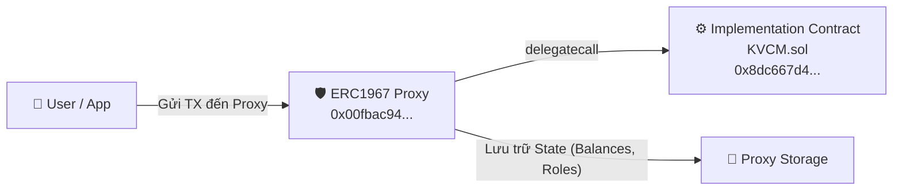
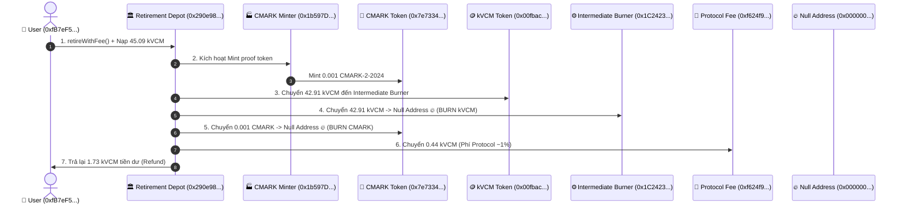
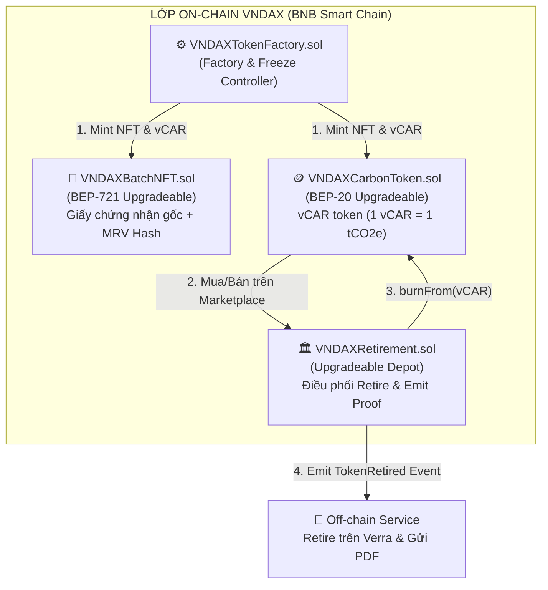

# Bóc Tách Chi Tiết Smart Contract & Luồng Blockchain Klima Protocol (kVCM) - Hướng Dẫn Áp Dụng Cho VNDAX

> **Tài liệu Kỹ thuật (Technical Reference)**  
> **Mục đích:** Phân tích toàn bộ kiến trúc Smart Contract `kVCM`, luồng tương tác giữa các bên liên quan trên Base chain, và cung cấp bản thiết kế mẫu (Contract Template) cho hệ thống **VNDAX Protocol**.

---

## 1. TỔNG QUAN KIẾN TRÚC SMART CONTRACT `kVCM`

### 1.1. Địa chỉ Smart Contract trên Base Chain

- **Proxy Contract (Địa chỉ giao dịch công khai):** `0x00fbac94fec8d4089d3fe979f39454f48c71a65d`
- **Implementation Contract (Chứa logic thực thi):** `0x8dc667d46cC90fE203E8B0aA4B59926e51073e56`
- **Mô hình Kiến trúc:** **UUPS (Universal Upgradeable Proxy Standard)** của OpenZeppelin.



> [!NOTE]
> **Tại sao dùng Proxy UUPS?**  
> Việc tách riêng ví lưu trữ dữ liệu (Proxy) và logic (Implementation) cho phép dự án cập nhật nâng cấp logic Smart Contract trong tương lai mà **không làm thay đổi địa chỉ hợp đồng**, bảo toàn toàn bộ số dư và dữ liệu người dùng.

---

## 2. BÓC TÁCH MÃ NGUỒN VERIFIED (CODE WALKTHROUGH)

### 2.1. Mã Nguồn Solidity Đầy Đủ (`KVCM.sol`)

Mã nguồn chính thức đã được verified trên BaseScan:

```solidity
// SPDX-License-Identifier: MIT
pragma solidity ^0.8.28;

import "@openzeppelin/contracts-upgradeable/token/ERC20/ERC20Upgradeable.sol";
import "@openzeppelin/contracts-upgradeable/token/ERC20/extensions/ERC20BurnableUpgradeable.sol";
import "@openzeppelin/contracts-upgradeable/token/ERC20/extensions/ERC20PermitUpgradeable.sol";
import "@openzeppelin/contracts-upgradeable/access/AccessControlUpgradeable.sol";
import "@openzeppelin/contracts-upgradeable/proxy/utils/Initializable.sol";
import "@openzeppelin/contracts-upgradeable/proxy/utils/UUPSUpgradeable.sol";

/**
 * @title KVCM Token
 * @dev Upgradeable ERC20 token with mint & burn capability, permit functionality, and role-based
 * access control
 */
contract KVCM is
    Initializable,
    ERC20Upgradeable,
    ERC20BurnableUpgradeable,
    ERC20PermitUpgradeable,
    AccessControlUpgradeable,
    UUPSUpgradeable
{
    // Định nghĩa các Role (Quyền hạn)
    bytes32 public constant MINTER_ROLE = keccak256("MINTER_ROLE");
    bytes32 public constant BURNER_ROLE = keccak256("BURNER_ROLE");
    bytes32 public constant UPGRADER_ROLE = keccak256("UPGRADER_ROLE");

    // Khai báo khoảng trống bộ nhớ cho việc upgrade an toàn
    uint256[50] private __gap;

    /// @custom:oz-upgrades-unsafe-allow constructor
    constructor() {
        _disableInitializers();
    }

    function initialize(
        string memory name,
        string memory symbol,
        uint256 initialSupply,
        address admin
    ) public initializer {
        __ERC20_init(name, symbol);
        __ERC20Burnable_init();
        __ERC20Permit_init(name);
        __AccessControl_init();
        __UUPSUpgradeable_init();

        // Gán toàn bộ quyền ban đầu cho Admin
        _grantRole(DEFAULT_ADMIN_ROLE, admin);
        _grantRole(UPGRADER_ROLE, admin);
        _grantRole(MINTER_ROLE, admin);
        _grantRole(BURNER_ROLE, admin);

        if (initialSupply > 0) {
            _mint(admin, initialSupply);
        }
    }

    function mint(address to, uint256 amount) public onlyRole(MINTER_ROLE) {
        _mint(to, amount);
    }

    function burn(uint256 amount) public override onlyRole(BURNER_ROLE) {
        _burn(_msgSender(), amount);
    }

    function burnFrom(address account, uint256 amount) public override onlyRole(BURNER_ROLE) {
        _spendAllowance(account, _msgSender(), amount);
        _burn(account, amount);
    }

    function _authorizeUpgrade(address) internal override onlyRole(UPGRADER_ROLE) {}
}
```

---

### 2.2. Giải Thích Chi Tiết Từng Thành Phần

#### 1. Kế thừa các chuẩn OpenZeppelin (`Inheritance`)

- **`Initializable`**: Thay thế `constructor()` truyền thống, cho phép gọi hàm `initialize()` một lần duy nhất khi deploy qua Proxy.
- **`ERC20Upgradeable`**: Cung cấp logic ERC-20 tiêu chuẩn (balanceOf, transfer, approve, allowance).
- **`ERC20BurnableUpgradeable`**: Cho phép tiêu hủy (burn) token. Trong `KVCM.sol`, hàm `burn` và `burnFrom` đã được override để gắn thêm phân quyền `onlyRole(BURNER_ROLE)`.
- **`ERC20PermitUpgradeable`**: Hỗ trợ chuẩn EIP-2612, cho phép người dùng ký off-chain (gasless approval) thay vì tốn gas gọi `approve()`.
- **`AccessControlUpgradeable`**: Phân quyền chi tiết (RBAC - Role-Based Access Control) bằng mã hash `keccak256`.
- **`UUPSUpgradeable`**: Đảm bảo điều kiện nâng cấp hợp đồng nằm ngay trong logic của contract cũ (`_authorizeUpgrade`).

#### 2. Phân Quyền Chi Tiết (Role-Based Access Control - RBAC)

- **`MINTER_ROLE`**: Quyền duy nhất được tạo thêm token `kVCM`. Chỉ gán cho Hợp đồng Cầu nối (Bridge) hoặc Admin được phê duyệt.
- **`BURNER_ROLE`**: Quyền duy nhất được gọi `burn()` hoặc `burnFrom()`. Chỉ gán cho Hợp đồng **Retirement Depot** (`0x290e98e9...`). Người dùng thông thường **không thể tự burn `kVCM`**, phải thông qua Depot.
- **`UPGRADER_ROLE`**: Quyền nâng cấp mã nguồn hợp đồng lên phiên bản mới.
- **`DEFAULT_ADMIN_ROLE`**: Quyền quản trị cao nhất, có thể trao hoặc tước các role khác.

#### 3. Hàm `burnFrom(address account, uint256 amount)`

Hàm này là **chìa khóa** cho luồng Retirement:

```solidity
function burnFrom(address account, uint256 amount) public override onlyRole(BURNER_ROLE) {
    _spendAllowance(account, _msgSender(), amount);
    _burn(account, amount);
}
```

- Khi người dùng gọi hàm `retireWithFee()` trên Retirement Depot:
  1. Depot kiểm tra hạn mức `allowance` mà người dùng cho phép Depot chi xài.
  2. Depot gọi `kVCM.burnFrom(userAddress, amount)`.
  3. `kVCM` trừ `allowance`, trực tiếp burn số `kVCM` khỏi ví của `userAddress` và chuyển vào Null address (`0x0000...0000`).

---

## 3. BÓC TÁCH TOÀN BỘ LUỒNG BLOCKCHAIN (INTERACTION FLOW)

Khi thực thi một giao dịch **"Retire Carbon"** (ví dụ Transaction `0x994a6ec5c9...`), hệ thống kết nối **5 bên tham gia**:

### 3.1. Các Bên Tham Gia Trực Tiếp

| Bên tham gia            | Địa chỉ Smart Contract / Ví                  | Vai trò trong hệ sinh thái                                                         |
| ----------------------- | -------------------------------------------- | ---------------------------------------------------------------------------------- |
| **1. User / Caller**    | `0xfB7eF581B0338A31e47AA9770345b26D46BF0451` | Người dùng/doanh nghiệp muốn bù trừ carbon.                                        |
| **2. Retirement Depot** | `0x290e98e95dacE244c73376C0c39A4D53b22E34B6` | **Orchestrator** (Bộ điều phối chính): Gọi mint/burn, tính phí, thối tiền.         |
| **3. kVCM Token**       | `0x00fbac94fec8d4089d3fe979f39454f48c71a65d` | **Payment Token**: Token thanh toán giá trị carbon (bị burn).                      |
| **4. CMARK Token**      | `0x7e73347d87fe9f00afbaafd19aa7f26dec72ffd5` | **Proof Token**: Token đại diện 1 dự án cụ thể, vintage 2024 (mint rồi burn ngay). |
| **5. Null Address**     | `0x0000000000000000000000000000000000000000` | "Hố đen" nhận token tiêu hủy vĩnh viễn.                                            |

---

### 3.2. Sơ Đồ Luồng Thực Thi Tương Tác 7 Bước (Sequence Diagram)

Toàn bộ 7 chuyển giao token diễn ra trong **1 Transaction duy nhất (~2 giây, tính Nguyên tử - Atomicity)**:



---

### 3.3. Phân Tích Ý Nghĩa Kỹ Thuật Của Luồng Mint-then-Burn

Một thắc mắc phổ biến: **Tại sao CMARK lại được Mint ra rồi Burn ngay lập tức trong cùng 1 Transaction?**

```
Luồng sự kiện (Events Log) ghi nhận trên Blockchain:
[Event 1] Transfer (from: 0x0000...0000, to: 0xdA0A79..., amount: 0.001 CMARK)
          ──▶ Bằng chứng: Tín chỉ carbon từ Dự án CMARK-2-2024 ĐÃ ĐƯỢC TẠO.

[Event 2] Transfer (from: 0xdA0A79..., to: 0x0000...0000, amount: 0.001 CMARK)
          ──▶ Bằng chứng: Tín chỉ carbon từ Dự án CMARK-2-2024 ĐÃ BỊ HỦY VĨNH VIỄN.
```

- **Mục đích:** Tạo ra **Proof-of-Retirement** (Bằng chứng bù trừ cryptographic bất biến).
- Nhờ có luồng này, bất kỳ ai (Explorer, Auditor) chỉ cần tra cứu Event Log của token `CMARK-2-2024` là có thể xác minh chính xác: **Ngày nào, giờ nào, ví nào đã bù trừ bao nhiêu tấn CO₂ của dự án nào.**

---

## 4. ÁP DỤNG MÔ HÌNH VÀO SMART CONTRACT VNDAX PROTOCOL

Dựa trên việc nghiên cứu `kVCM`, dưới đây là bản thiết kế hệ thống Smart Contract dành riêng cho **VNDAX Protocol** (mô hình Marketplace tập trung, tuân thủ pháp lý Việt Nam, không có DEX pool).

### 4.1. Bộ 3 Hợp Đồng Cốt Lõi VNDAX



---

### 4.2. Mã Nguồn Mẫu 1: `VNDAXCarbonToken.sol` (BEP-20)

Áp dụng chuẩn `KVCM.sol` của Klima nhưng tinh chỉnh cho chuẩn BEP-20 và tích hợp sẵn với `VNDAXRetirement`:

```solidity
// SPDX-License-Identifier: MIT
pragma solidity ^0.8.28;

import "@openzeppelin/contracts-upgradeable/token/ERC20/ERC20Upgradeable.sol";
import "@openzeppelin/contracts-upgradeable/token/ERC20/extensions/ERC20BurnableUpgradeable.sol";
import "@openzeppelin/contracts-upgradeable/access/AccessControlUpgradeable.sol";
import "@openzeppelin/contracts-upgradeable/proxy/utils/Initializable.sol";
import "@openzeppelin/contracts-upgradeable/proxy/utils/UUPSUpgradeable.sol";

/**
 * @title VNDAXCarbonToken (vCAR)
 * @dev Hợp đồng đại diện cho 1 lô tín chỉ carbon cụ thể (ví dụ: vCAR-LongHuu-2026)
 */
contract VNDAXCarbonToken is
    Initializable,
    ERC20Upgradeable,
    ERC20BurnableUpgradeable,
    AccessControlUpgradeable,
    UUPSUpgradeable
{
    bytes32 public constant MINTER_ROLE = keccak256("MINTER_ROLE");
    bytes32 public constant BURNER_ROLE = keccak256("BURNER_ROLE");
    bytes32 public constant UPGRADER_ROLE = keccak256("UPGRADER_ROLE");

    uint256 public batchNftId; // Kết nối với NFT Lô Gốc
    string public projectMetadataUri; // IPFS URI tài liệu MRV

    uint256[48] private __gap;

    /// @custom:oz-upgrades-unsafe-allow constructor
    constructor() {
        _disableInitializers();
    }

    function initialize(
        string memory name,
        string memory symbol,
        uint256 _batchNftId,
        string memory _metadataUri,
        address admin,
        address minter,
        address burner
    ) public initializer {
        __ERC20_init(name, symbol);
        __ERC20Burnable_init();
        __AccessControl_init();
        __UUPSUpgradeable_init();

        batchNftId = _batchNftId;
        projectMetadataUri = _metadataUri;

        _grantRole(DEFAULT_ADMIN_ROLE, admin);
        _grantRole(UPGRADER_ROLE, admin);
        _grantRole(MINTER_ROLE, minter);
        _grantRole(BURNER_ROLE, burner); // Gán quyền BURNER_ROLE cho VNDAXRetirement
    }

    function mint(address to, uint256 amount) public onlyRole(MINTER_ROLE) {
        _mint(to, amount);
    }

    function burnFrom(address account, uint256 amount) public override onlyRole(BURNER_ROLE) {
        _spendAllowance(account, _msgSender(), amount);
        _burn(account, amount);
    }

    function _authorizeUpgrade(address) internal override onlyRole(UPGRADER_ROLE) {}
}
```

---

### 4.3. Mã Nguồn Mẫu 2: `VNDAXRetirement.sol` (Hợp đồng Bù Trừ)

Phỏng theo logic `Retirement Depot` của Klima, phụ trách gọi `burnFrom` và tạo bằng chứng on-chain:

```solidity
// SPDX-License-Identifier: MIT
pragma solidity ^0.8.28;

import "@openzeppelin/contracts-upgradeable/access/AccessControlUpgradeable.sol";
import "@openzeppelin/contracts-upgradeable/proxy/utils/Initializable.sol";
import "@openzeppelin/contracts-upgradeable/proxy/utils/UUPSUpgradeable.sol";
import "@openzeppelin/contracts-upgradeable/utils/ReentrancyGuardUpgradeable.sol";

interface IVNDAXCarbonToken {
    function burnFrom(address account, uint256 amount) external;
}

/**
 * @title VNDAXRetirement
 * @dev Hợp đồng điều phối bù trừ carbon cho doanh nghiệp B2B
 */
contract VNDAXRetirement is
    Initializable,
    AccessControlUpgradeable,
    ReentrancyGuardUpgradeable,
    UUPSUpgradeable
{
    bytes32 public constant UPGRADER_ROLE = keccak256("UPGRADER_ROLE");

    // Sự kiện phục vụ Event Listener off-chain
    event CarbonRetired(
        address indexed beneficiary, // Ví doanh nghiệp bù trừ
        address indexed carbonTokenAddress, // Địa chỉ token vCAR bị burn
        uint256 amount, // Số lượng (tCO2e)
        string entityName, // Tên doanh nghiệp (ví dụ: "Công ty ABC")
        string retirementReason, // Lý do ("Báo cáo CBAM Q3/2026")
        uint256 timestamp
    );

    uint256[50] private __gap;

    /// @custom:oz-upgrades-unsafe-allow constructor
    constructor() {
        _disableInitializers();
    }

    function initialize(address admin) public initializer {
        __AccessControl_init();
        __ReentrancyGuard_init();
        __UUPSUpgradeable_init();

        _grantRole(DEFAULT_ADMIN_ROLE, admin);
        _grantRole(UPGRADER_ROLE, admin);
    }

    /**
     * @notice Thực hiện bù trừ vCAR token
     * @param carbonToken Address của vCAR contract
     * @param amount Số lượng token cần burn
     * @param entityName Tên doanh nghiệp/cá nhân thụ hưởng chứng nhận
     * @param retirementReason Lý do bù trừ
     */
    function retireCarbon(
        address carbonToken,
        uint256 amount,
        string memory entityName,
        string memory retirementReason
    ) external nonReentrant {
        require(amount > 0, "Amount must be greater than 0");

        // 1. Thực thi burn vCAR từ ví người gọi (yêu cầu User đã approve allowance)
        IVNDAXCarbonToken(carbonToken).burnFrom(msg.sender, amount);

        // 2. Phả sự kiện On-chain (Proof-of-Retirement)
        emit CarbonRetired(
            msg.sender,
            carbonToken,
            amount,
            entityName,
            retirementReason,
            block.timestamp
        );
    }

    function _authorizeUpgrade(address) internal override onlyRole(UPGRADER_ROLE) {}
}
```

---

## 5. SO SÁNH SO BÓC TÁCH: KLIMA VS. VNDAX

| Hạng mục              | Klima Protocol (Base chain)            | VNDAX Protocol (BNB Chain)                                  |
| --------------------- | -------------------------------------- | ----------------------------------------------------------- |
| **Cơ chế Mint**       | AccessControl (`MINTER_ROLE`)          | AccessControl (`MINTER_ROLE` via Factory)                   |
| **Cơ chế Burn**       | AccessControl (`BURNER_ROLE` on Depot) | AccessControl (`BURNER_ROLE` on `VNDAXRetirement`)          |
| **Upgrade Pattern**   | UUPS Proxy (`Initializable`)           | UUPS Proxy (`Initializable`)                                |
| **Xác nhận Proof**    | Mint → Burn CMARK token trong 1 TX     | Emit Event `CarbonRetired` + Metadata NFT BEP-721           |
| **Token Mua Bán**     | **kVCM (CÓ Market / Liquidity Pool)**  | **vCAR (KHÔNG Market / Mua trực tiếp)**                     |
| **Đồng bộ Off-chain** | Không có (xử lý thuần On-chain)        | Event Listener bắt `CarbonRetired` → Retire Verra off-chain |

---

## 6. KẾT LUẬN & HƯỚNG DẪN TRIỂN KHAI CHO CTO

1. **Về mặt Smart Contract Architecture:** VNDAX kế thừa 100% tư duy phân quyền (RBAC) và mô hình UUPS Proxy từ Klima. Việc khóa quyền `burn` chỉ cho hợp đồng `VNDAXRetirement` giúp bảo đảm không ai tự ý burn token sai quy trình.
2. **Về mặt Data Flow:** Không cần tạo thêm token CMARK phức tạp như Klima. VNDAX tận dụng **`VNDAXBatchNFT` (BEP-721)** để lưu thông tin gốc dự án (như Long Hựu 2026) và emit event `CarbonRetired` từ `VNDAXRetirement.sol` để hệ thống Backend bắt sự kiện, tự động xuất chứng chỉ PDF và thực hiện thủ tục Retire trên Verra Registry off-chain.
