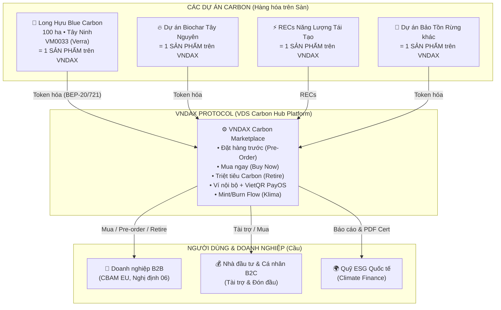
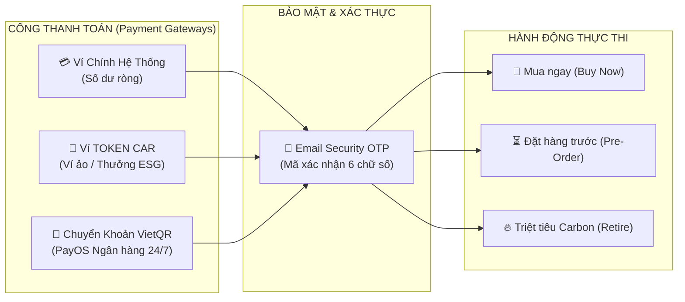
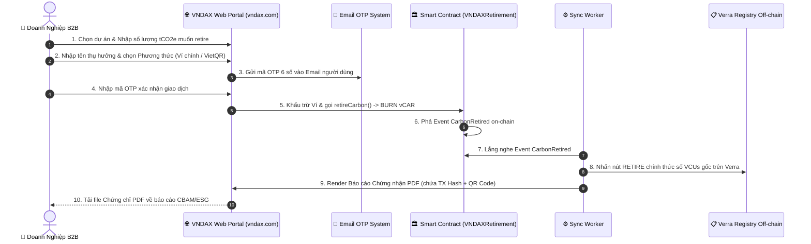

# Phân Tích Tổng Quan Hệ Sinh Thái Dự Án VNDAX

> Tài liệu này tổng hợp phân tích từ: (1) Sách Trắng Giao thức VNDAX, (2) Đề án Tín chỉ Carbon Rừng ngập mặn Long Hựu, (3) Phân tích thực tế website live `https://vndax.com/vi` (VDS Carbon Hub), (4) Smart Contract Klima Protocol `KVCM.sol` trên Base chain, và (5) So sánh với Carbonmark/Klima/Toucan/Flowcarbon.

> [!IMPORTANT]
> **Cập nhật thực tế từ Website Live (`vndax.com/vi`):**
>
> - **VNDAX (VDS Carbon Hub)** là **Sàn Giao Dịch & Marketplace Tín Chỉ Carbon** chính thức tại Việt Nam.
> - **Phương thức Thanh toán & Ví:** Sử dụng **Ví Nội Bộ** (Ví chính hệ thống, Ví ảo TOKEN CAR) kết hợp cổng **VietQR (PayOS)** và xác thực **OTP qua Email** (Web2.5 UX mượt mà cho doanh nghiệp B2B, không bắt buộc cài ví MetaMask).
> - **Luồng Nghiệp Vụ:** Hỗ trợ 3 luồng chính: **Mua ngay (Buy Now)**, **Đặt hàng trước (Pre-Order)**, và **Triệt tiêu/Bù trừ Carbon (Retire Now)** với chứng chỉ Verra/Gold Standard.
> - **Cơ chế Blockchain:** Áp dụng **Flow Mint/Burn & Proof-of-Retirement của KlimaDAO** ở lớp blockchain bên dưới, kết hợp với giao diện **Marketplace trực tiếp của Carbonmark & VDS Carbon Hub**.
> - **Long Hựu:** Là **1 sản phẩm/dự án tiêu biểu (pilot project)** được token hóa và list trên Marketplace VNDAX.

---

## 1. BỨC TRANH TOÀN CẢNH - VNDAX đang xây gì?

VNDAX (VDS Carbon Hub) là **hạ tầng Marketplace & Sàn giao dịch Carbon** tập trung tại Việt Nam & ASEAN, nơi các dự án carbon trong và ngoài nước được **Token hóa, List, Đặt hàng trước, Giao dịch và Triệt tiêu (Retire)**.



> [!IMPORTANT]
> **Long Hựu = 1 SẢN PHẨM trên VNDAX Marketplace.** Tương tự như cách `CMARK-2-2024` là 1 project được list trên Klima Protocol / Carbonmark. Long Hựu KHÔNG phải là nền tảng - nó là **hàng hóa** (tín chỉ carbon) được list trên sàn VNDAX.

---

## 2. KIẾN TRÚC & PHƯƠNG THỨC VẬN HÀNH CỦA VNDAX

### 2.1. Cổng Thanh Toán & Trải Nghiệm Người Dùng (Web2.5 UX)

Theo đặc tả thực tế từ website `vndax.com/vi`, VNDAX tối ưu trải nghiệm người dùng B2B Việt Nam bằng cách **loại bỏ rào cản kỹ thuật Web3**:



---

### 2.2. Cơ Chế Mint/Burn & Bù Trừ Carbon (Klima Flow)

Mặc dù giao diện người dùng sử dụng Ví Nội Bộ và VietQR, **ở lớp Smart Contract bên dưới**, VNDAX kế thừa 100% tư duy mint/burn bất biến từ **Klima Protocol**:

```solidity
// Tương thích mã nguồn KVCM.sol của Klima trên Base chain:
bytes32 public constant MINTER_ROLE = keccak256("MINTER_ROLE");
bytes32 public constant BURNER_ROLE = keccak256("BURNER_ROLE");

// 1. Admin Multi-sig đúc vCAR Token khi Freeze tín chỉ Verra gốc
function mint(address to, uint256 amount) public onlyRole(MINTER_ROLE) {
    _mint(to, amount);
}

// 2. Hợp đồng VNDAXRetirement thực thi burnFrom() khi người dùng Retire
function burnFrom(address account, uint256 amount) public override onlyRole(BURNER_ROLE) {
    _spendAllowance(account, _msgSender(), amount);
    _burn(account, amount);
}
```

---

### 2.3. So Sánh Tính Năng: Klima vs. Carbonmark vs. VNDAX (`vndax.com`)

| Tiêu chí                   | Klima Protocol                            | Carbonmark              | **VNDAX Protocol (`vndax.com`)**                   |
| -------------------------- | ----------------------------------------- | ----------------------- | -------------------------------------------------- |
| **Mô hình**                | DEX & Bù trừ                              | Marketplace trực tiếp   | **Marketplace Carbon + Ví Nội Bộ & VietQR**        |
| **Blockchain**             | Base Chain                                | Polygon                 | **BNB Smart Chain**                                |
| **Phương thức thanh toán** | Token `kVCM` (Web3 wallet)                | USDC (Web3 wallet)      | **Ví chính nội bộ, Ví TOKEN CAR, VietQR (PayOS)**  |
| **Xác thực giao dịch**     | MetaMask / Signer                         | MetaMask                | **Email OTP (6 chữ số)**                           |
| **Tính năng chính**        | Retire, Swap, Stake                       | Buy, Retire             | **Buy Now, Pre-Order, Retire Now, Cấp PDF Cert**   |
| **Cơ chế Mint/Burn**       | Role-based (`MINTER_ROLE`, `BURNER_ROLE`) | Off-chain Registry Sync | **Role-based (Klima Flow) + Sync Verra Off-chain** |
| **Bằng chứng Proof**       | Event `CarbonRetired` + CMARK             | Event on-chain          | **Event `CarbonRetired` + PDF Cert + QR Code**     |
| **Pháp lý & KYC**          | Không KYC                                 | Nhẹ                     | **eKYC Bắt buộc (Nghị định 13/2023/NĐ-CP)**        |

---

## 3. QUY TRÌNH BÙ TRỪ CARBON VÀ XUẤT CHỨNG CHỈ (PDF CERTIFICATE)

Khi người dùng thực hiện lệnh **"Triệt tiêu Carbon (Retire)"** trên VNDAX:



---

## 4. DỰ ÁN PHẢN ÁNH THỰC TẾ: RỪNG NGẬP MẶN LONG HỰU

- **Tên:** Đề án Tín chỉ Carbon Rừng ngập mặn Long Hựu (Tây Ninh).
- **Quy mô:** 100 ha rừng ngập mặn, hấp thụ ~2,480 tCO₂e/năm.
- **Tiêu chuẩn:** Verra VCS VM0033.
- **Vai trò trên VNDAX:** Là **Dự án nổi bật đầu tiên (Pilot Project)** được token hóa thành:
  - `VNDAXBatchNFT #001` (BEP-721 Giấy chứng nhận gốc lưu SHA-256 MRV Hash trên IPFS).
  - `vCAR-BC-2026` (BEP-20 Token đại diện 2,480 tCO₂e cho niên độ 2026).

---

## 5. KẾT LUẬN & ĐỊNH HƯỚNG DÀNH CHO CTO

1. **Giữ nguyên 100% Cơ chế Blockchain từ Klima:** Hệ thống Smart Contract đúc/đốt token, phân quyền `MINTER_ROLE`, `BURNER_ROLE` và phả event `CarbonRetired` hoàn toàn kế thừa từ Klima Protocol để đảm bảo tính minh bạch và uy tín.
2. **Giao diện & Thanh toán Web2.5 (vndax.com):** Dùng Ví nội bộ (Main/Virtual) và cổng VietQR (PayOS) kết hợp xác minh Email OTP để người dùng doanh nghiệp Việt Nam không phải qua các bước cài ví Web3 phức tạp.
3. **Cung cấp đủ 3 luồng:** Mua ngay (Buy Now), Đặt mua trước (Pre-Order), và Triệt tiêu (Retire Now) kèm xuất PDF Chứng chỉ có mã QR xác minh.
