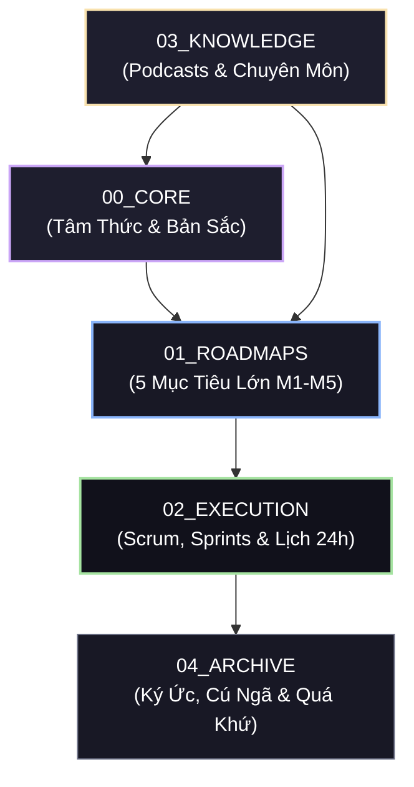

# 🌐 HIEU LIFE OS (SECOND BRAIN) — MAP OF CONTENT (MOC)

> **Hệ Điều Hành Cuộc Đời & Kho Tri Thức Thứ Hai Của Lê Văn Hiếu (25 Tuổi)**  
> *Được cấu trúc theo mô hình Second Brain chuẩn mực: Gốc rễ tư duy ➔ Lộ trình tương lai ➔ Cỗ máy thực thi ➔ Bách khoa tri thức ➔ Bảo tàng ký ức.*

---

## 🗺️ I. BẢN ĐỒ KIẾN TRÚC 5 TRỤ CỘT (THE 5 PILLARS)



| Trụ cột | Tên thư mục | Ý nghĩa & Vai trò | Tần suất truy cập |
| :--- | :--- | :--- | :--- |
| **00** | [00_CORE/](./00_CORE/) | **Gốc rễ & La bàn:** Hiếu là ai, định vị High-Value Man, tâm pháp Hieu TV & Dan Foolish, 5 vùng cấm kỷ luật. | Khi mất phương hướng / Cuối sprint |
| **01** | [01_ROADMAPS/](./01_ROADMAPS/) | **5 Đỉnh núi lớn (M1–M5):** Tiếng Anh 700+, Tài chính 43M/2 Tỷ, Thể chất 75kg, Senior TMA & Thạc sĩ UIT, Quỹ mẹ 500tr. | Hàng tuần / Khi lập kế hoạch |
| **02** | [02_EXECUTION/](./02_EXECUTION/) | **Cỗ máy thực thi:** Sprint 2 tuần (S1, S2...), Daily Schedule 24h, 2 Van xả, Daily Journal từ năm 24 tuổi. | **Hàng ngày** (Sáng & Tối) |
| **03** | [03_KNOWLEDGE/](./03_KNOWLEDGE/) | **Kho tri thức Second Brain:** Đúc kết 7 podcasts Dan Foolish, 29 podcasts Hieu TV, AI Engineer, System Design, CI/CD. | Khi học tập & nghiên cứu |
| **04** | [04_ARCHIVE/](./04_ARCHIVE/) | **Bảo tàng ký ức & Quá khứ:** Các dự án đóng băng (Miracle POS, TikTok, MBA), sprint cũ, bài học sau các cú ngã. | Tham khảo / Ôn lại bài học |

---

## 🎯 II. ĐIỀU HƯỚNG THEO 5 MỤC TIÊU LỚN (M1 – M5)

### 🗣️ M1 · TIẾNG ANH (TOEIC 700+ & GIAO TIẾP TỰ TIN)
> *Đích đến: Thi cuối T06/2027 · Hạn chót nộp TMA: 15/11/2027 để lên Senior.*
* 🗺️ **Lộ trình tổng quan:** [TOEIC_ROADMAP.md](./01_ROADMAPS/M1_ENGLISH/toeic/TOEIC_ROADMAP.md)
* 🎓 **Coach 1:1 Kim Hân 2027 (955 TOEIC):** [COACH_1ON1_KIM_HAN_2027.md](./01_ROADMAPS/M1_ENGLISH/toeic/COACH_1ON1_KIM_HAN_2027.md)
* 🗣️ **Giao tiếp Immersion Level 3 (Khai giảng 20/10):** [IMMERSION_ROADMAP.md](./01_ROADMAPS/M1_ENGLISH/communication/IMMERSION_ROADMAP.md) | [LEVEL_3_TOPIC_LOG.md](./01_ROADMAPS/M1_ENGLISH/communication/LEVEL_3_TOPIC_LOG.md)
* 🛡️ **Chiến lược Helen English:** [HELEN_ENGLISH_STRATEGY.md](./01_ROADMAPS/M1_ENGLISH/toeic/HELEN_ENGLISH_STRATEGY.md)
* 📝 **Sổ tay lỗi sai & Từ vựng:** [TOEIC_ERROR_MASTER.md](./01_ROADMAPS/M1_ENGLISH/toeic/TOEIC_ERROR_MASTER.md) | [VOCABULARY_52_WEEKS.md](./01_ROADMAPS/M1_ENGLISH/toeic/VOCABULARY_52_WEEKS.md)
* 🏋️ **Khu vực luyện thi & Mock Tests:** [practice/](./01_ROADMAPS/M1_ENGLISH/practice/) (ETS Grinding Plan, Mock tests, Speaking/Listening logs)

---

### 💰 M2 · TÀI CHÍNH (43M THẠC SĨ UIT & TỰ DO 2 TỶ 2031)
> *Đích đến: Đủ 43tr học phí năm 1 T11/2026 (đóng T12/2027); Chạm trần tiền mặt 50M T12/2026; Đích xa 2 Tỷ 2031.*
* 📊 **Kế hoạch tài chính 2026–2028:** [TAI_CHINH_2026_2028.md](./01_ROADMAPS/M2_FINANCE/TAI_CHINH_2026_2028.md)
* 💎 **Chiến lược đầu tư & Danh mục W:** [DAU_TU.md](./01_ROADMAPS/M2_FINANCE/DAU_TU.md)
* ⚖️ **Nguyên tắc kế toán & Phân tách tài sản:** [NGUYEN_TAC_KE_TOAN.md](./01_ROADMAPS/M2_FINANCE/NGUYEN_TAC_KE_TOAN.md)
* 📈 **Bảng tổng kết tài sản tháng:** [MONTHLY_TRACKER.md](./01_ROADMAPS/M2_FINANCE/MONTHLY_TRACKER.md)
* 📝 **Nhật ký thu chi từng tháng:** [T10_2026_GIAO_DICH.md](./01_ROADMAPS/M2_FINANCE/trackers/T10_2026_GIAO_DICH.md) | [T09_...](./01_ROADMAPS/M2_FINANCE/trackers/T09_2026_GIAO_DICH.md) | [T08_...](./01_ROADMAPS/M2_FINANCE/trackers/T08_2026_GIAO_DICH.md)

---

### 💪 M3 · THỂ CHẤT & SỨC KHỎE (INBODY 72–75KG)
> *Đích đến: Cân nặng 72-75kg, body fat 7-10%, ngủ đúng 23:30, da mặt cải thiện.*
* 🏋️ **Giáo án Gym 4 buổi/tuần & Tracking InBody:** [GYM_PLAN.md](./01_ROADMAPS/M3_HEALTH/GYM_PLAN.md)
* ⏰ **Nhịp sinh hoạt 24h & 2 Van xả stress:** [DAILY_SCHEDULE.md](./02_EXECUTION/DAILY_SCHEDULE.md)
* 🛡️ **Bài học kỷ luật sức khỏe Dan Foolish (95kg ➔ 75kg):** [VUOT_QUA_SU_TRI_HOAN.md](./03_KNOWLEDGE/podcasts/dan_foolish/VUOT_QUA_SU_TRI_HOAN.md)

---

### 🎓 M4 · SỰ NGHIỆP & HỌC THUẬT (SENIOR TMA 2027 & THẠC SĨ UIT)
> *Đích đến: Senior Software Engineer TMA (2027) ➔ Thạc sĩ CS UIT (2027-2029) ➔ Giảng viên Đại học (2029).*
* 🏛️ **Kế hoạch Thạc sĩ Khoa học Máy tính UIT:** [THAC_SI_UIT_2027.md](./01_ROADMAPS/M4_CAREER/master_uit/THAC_SI_UIT_2027.md)
* 🏢 **Tài liệu & Dự án tại TMA Solutions:** [01_ROADMAPS/M4_CAREER/tma/](./01_ROADMAPS/M4_CAREER/tma/)
* 🗺️ **Roadmap Chuyên Môn Kỹ Thuật:**
  * Flutter Master & System Design: [roadmapsh_flutter.md](./01_ROADMAPS/M4_CAREER/tech_roadmaps/roadmapsh_flutter.md) | [eduone_flutter_system_design.md](./01_ROADMAPS/M4_CAREER/tech_roadmaps/eduone_flutter_system_design.md)
  * AI Engineer & Agent Roadmap: [roadmapsh_ai_engineer.md](./03_KNOWLEDGE/engineering/ai_engineer/roadmapsh_ai_engineer.md) | [ai_agent_roadmap.md](./03_KNOWLEDGE/engineering/ai_engineer/ai_agent_roadmap.md)

---

### ❤️ M5 · GIA ĐÌNH & MỐI QUAN HỆ (QUỸ MẸ 500TR & BẠN ĐỜI)
> *Đích đến: Báo hiếu mẹ 500tr (đã gửi 8tr luỹ kế, 2M/tháng); Xây dựng quan hệ bạn đời Win-Win vững chắc.*
* 👵 **Quỹ phụng dưỡng Mẹ 500tr:** [QUY_ME_500TR.md](./01_ROADMAPS/M5_RELATIONSHIPS/QUY_ME_500TR.md) *(hoặc [M2_FINANCE/QUY_ME_500TR.md](./01_ROADMAPS/M2_FINANCE/QUY_ME_500TR.md))*
* 🤝 **Nguyên tắc gia đình, bạn bè & Tiêu chí bạn đời:** [RELATIONSHIPS.md](./01_ROADMAPS/M5_RELATIONSHIPS/RELATIONSHIPS.md)
* 🐺 **Khí chất High-Value Man trong hẹn hò:** [DATING_CORE_PRINCIPLES.md](./01_ROADMAPS/M5_RELATIONSHIPS/dating/DATING_CORE_PRINCIPLES.md) | [HIEU_MINDSET.md](./00_CORE/HIEU_MINDSET.md)

---

## ⚡ III. CỖ MÁY THỰC THI (DAILY / WEEKLY / SPRINT EXECUTION)

```
02_EXECUTION/
├── SPRINT HIỆN TẠI:        sprints/S1.md (12/10 → 25/10/2026 - Mỗi sáng mở 1 phút)
├── LỊCH TRÌNH 24H:         DAILY_SCHEDULE.md (Lịch chi tiết, 2 van xả T4 & CN)
├── NHẬT KÝ CUỘC ĐỜI:       DAILY_JOURNAL.md (Ghi lại hành trình từ 24 tuổi)
├── QUY CHẾ SCRUM:          SCRUM_FRAMEWORK.md (Chu kỳ 2 tuần, check-in CN 21:00)
└── LỊCH SPRINT CẢ NĂM:     SPRINT_CALENDAR.md (Mốc quý & tiến độ các Sprint)
```

---

## 🧠 IV. BÁCH KHOA TOÀN THƯ SECOND BRAIN (KNOWLEDGE BASE)

### 🎙️ 1. Kho Podcasts Thực Chiến — Dan Foolish
* [20_DIEU_THAY_DOI_CUOC_DOI_BAN.md](./03_KNOWLEDGE/podcasts/dan_foolish/20_DIEU_THAY_DOI_CUOC_DOI_BAN.md) — 20 Nguyên tắc đổi đời sau 10 năm khởi nghiệp từ số 0.
* [10_DIEU_GIUP_BAN_TU_DO_TAI_CHINH.md](./03_KNOWLEDGE/podcasts/dan_foolish/10_DIEU_GIUP_BAN_TU_DO_TAI_CHINH.md) — 10 Đòn bẩy tự do tài chính thực chiến, đập tan bẫy "chữa lành".
* [7_DIEU_TOI_UOC_DUOC_BIET_NAM_20_TUOI.md](./03_KNOWLEDGE/podcasts/dan_foolish/7_DIEU_TOI_UOC_DUOC_BIET_NAM_20_TUOI.md) — 7 Chân lý đầu tư bản thân, sức khỏe và tự lập 100%.
* [LAM_SAO_DE_BAT_DAU_MOI_VIEC.md](./03_KNOWLEDGE/podcasts/dan_foolish/LAM_SAO_DE_BAT_DAU_MOI_VIEC.md) — Phá vỡ bẫy an toàn, nguyên lý bước đi nhỏ nhất (Micro-actions).
* [VUOT_QUA_SU_TRI_HOAN.md](./03_KNOWLEDGE/podcasts/dan_foolish/VUOT_QUA_SU_TRI_HOAN.md) — Tiêu diệt "Bùi Lan", trì hoãn có chọn lọc, bài học sức khỏe 95kg ➔ 75kg.
* [LAM_SAO_KIEN_TRI_DEN_CUNG_MOI_VIEC.md](./03_KNOWLEDGE/podcasts/dan_foolish/LAM_SAO_KIEN_TRI_DEN_CUNG_MOI_VIEC.md) — 3 Trụ cột động lực, vượt thung lũng tuyệt vọng trên J-Curve.
* [TU_DUY_TU_TIN_DUNG.md](./03_KNOWLEDGE/podcasts/dan_foolish/TU_DUY_TU_TIN_DUNG.md) — Tự tin từ thực lực thật, khiêm tốn ở đáy, nguyên tắc "Luôn cần đối phương".

### 🎧 2. Kho Podcasts Tâm Pháp Cuộc Sống — Hieu TV
* [03_KNOWLEDGE/podcasts/hieu_tv/](./03_KNOWLEDGE/podcasts/hieu_tv/) — Trọn bộ 29 podcasts (Cặm cụi tự học, Hai mặt giá trị, Sống không hối tiếc, Quản trị kỳ vọng, Tự do tài chính).

### 💻 3. Kho Công Nghệ & Kỹ Thuật (Engineering Hub)
* **AI & Agent Engineering:** [ai_engineer/](./03_KNOWLEDGE/engineering/ai_engineer/) (MCP servers, Python Content Extractor, Roadmaps).
* **CI/CD & DevOps:** [ci_cd/](./03_KNOWLEDGE/engineering/ci-cd/) (Flutter pipelines, Deployment).
* **Tooling:** [vscode_extension/](./03_KNOWLEDGE/engineering/vscode_extension/) (Viet Translate extension).

---

## 🏛️ V. BẢO TÀNG KÝ ỨC & QUÁ KHỨ (04_ARCHIVE)

* [past_sprints/](./04_ARCHIVE/past_sprints/) — Lưu trữ các Sprint cũ thời kỳ thử nghiệm.
* [frozen_projects/miracle/](./04_ARCHIVE/frozen_projects/miracle/) — Đề án VNDAX, Tín chỉ Carbon, Miracle POS (đang đóng băng).
* [frozen_projects/tiktok/](./04_ARCHIVE/frozen_projects/tiktok/) — Dự án TikTok cũ đã dừng để dồn sức cho M1-M5.
* [business_mba/](./04_ARCHIVE/business_mba/) — Toàn bộ tài liệu học Quản trị kinh doanh, Marketing, Kinh tế vi mô.

---

## 🔍 VI. BẢNG TRA CỨU NHANH THEO TÌNH HUỐNG (FAST QUERY CHEAT SHEET)

| Tình huống thực tế của Hiếu | Mở ngay file này | Mục đích |
| :--- | :--- | :--- |
| **Mỗi sáng thức dậy (07:00)** | [02_EXECUTION/sprints/S1.md](./02_EXECUTION/sprints/S1.md) | Xem task trọng tâm hôm nay (1 phút). |
| **Quên lịch sinh hoạt / Giờ giấc** | [02_EXECUTION/DAILY_SCHEDULE.md](./02_EXECUTION/DAILY_SCHEDULE.md) | Xem khung giờ 24h & nguyên tắc 2 van xả. |
| **Vừa tiêu tiền / Chuyển khoản** | [T10_2026_GIAO_DICH.md](./01_ROADMAPS/M2_FINANCE/trackers/T10_2026_GIAO_DICH.md) | Ghi nhận chi tiêu ngay lập tức. |
| **Khi thấy nản / Mất động lực** | [00_CORE/HIEU_MINDSET.md](./00_CORE/HIEU_MINDSET.md) | Đọc lại Bộ Tam Kiếm Thực Thi & 3 Trụ Cột Động Lực. |
| **Khi làm bài TOEIC bị điểm thấp** | [TOEIC_ERROR_MASTER.md](./01_ROADMAPS/M1_ENGLISH/toeic/TOEIC_ERROR_MASTER.md) | Tra cứu dạng bẫy và ghi nhận lỗi sai. |
| **Đến ngày nhận lương (Mùng 5)** | [QUY_ME_500TR.md](./01_ROADMAPS/M5_RELATIONSHIPS/QUY_ME_500TR.md) | Chuyển khoản 2M cho mẹ ngay trước khi chi tiêu. |
| **Trước khi đi ngủ (23:00)** | [02_EXECUTION/DAILY_JOURNAL.md](./02_EXECUTION/DAILY_JOURNAL.md) | Viết vài dòng phản tỉnh ngắn cuối ngày. |
| **Cuối tuần / Cuối Sprint (CN 21:00)** | [02_EXECUTION/SCRUM_FRAMEWORK.md](./02_EXECUTION/SCRUM_FRAMEWORK.md) | Check-in Sprint 15 phút, review kết quả. |

---

_Hiếu Life OS v2.0 — Tái cấu trúc ngày 17/10/2026. Tối ưu hóa 100% cho tìm kiếm nhanh, liên kết chặt chẽ và thực thi kỷ luật._
